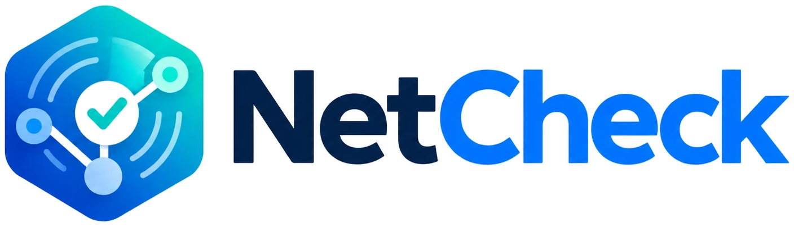
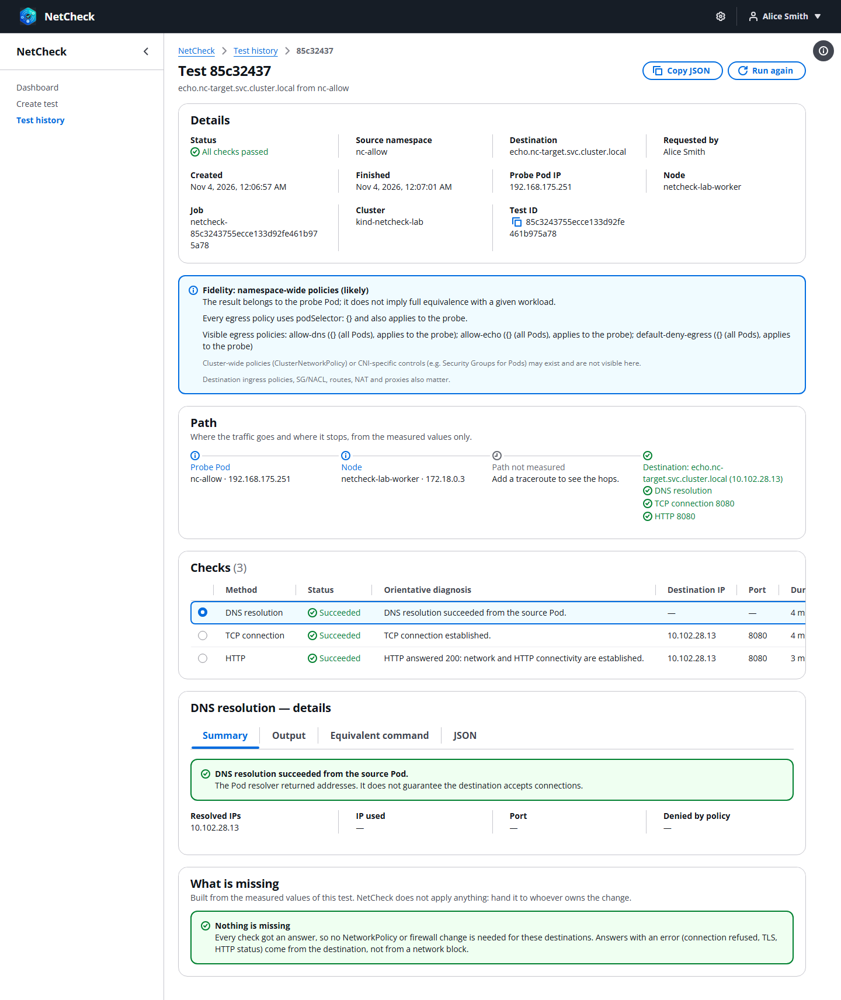

<p align="center">
  
</p>

<p align="center">
  <a href="https://github.com/hgeorge123/netcheck/actions/workflows/ci.yml"></a>
  <a href="LICENSE"></a>
  <a href="https://github.com/hgeorge123/netcheck/releases"></a>
</p>

**NetCheck** answers a question every platform team hears daily: *"Can my application in namespace X reach host Y on
port Z?"* It runs network checks **from inside the namespace you pick**, so the result reflects the same
NetworkPolicies, DNS and routes your workloads get, and it explains the result in plain language.

Nothing is installed in your application namespaces. For each test NetCheck starts a short-lived, locked-down probe
Pod, measures, collects the result through the Kubernetes API and deletes the Pod.



## Features

- **Checks:** DNS, TCP, HTTP, HTTPS, ping and traceroute. ICMP works without privileges (no `NET_RAW`, no root).
- **Firewall ticket mode:** enter a destination and a port and get one block of `date`, `hostname`, `ping`,
  `traceroute`, `telnet` and `curl -v` output, ready to paste, plus the real Pod and node IPs the firewall will see.
- **Readable diagnosis:** every result says what it means *and what it does not mean* (a timeout is not proof of a
  NetworkPolicy block; an HTTP 503 is not a network failure), with an equivalent command to reproduce it by hand.
- **Fidelity notice:** tells you whether the namespace's egress policies apply to the probe exactly as to your
  workloads.
- **Users and roles:** built-in accounts with `admin` and `user` roles, per-user namespaces (a fixed list or "all",
  including future namespaces), active sessions, audit log.
- **Administration from the web:** destination policy, namespace exclusions and data retention, applied immediately
  without redeploying.
- **Secure by default:** probes run a shell-less Go binary pinned by digest, as non-root with no capabilities, no
  token and no cloud credentials. Native `ValidatingAdmissionPolicies` restrict what the controller can create even if
  its token leaks. Cloud metadata and the API server are never reachable from a test.
- **Simple to run:** one Pod, SQLite on a persistent volume, one Helm chart. English and Spanish interface.

## How it works

```
Browser ─HTTPS─► Gateway API / Ingress ─► netcheck (Go API + React UI + controller, SQLite)
                                                   │ Kubernetes API: create Job, read logs
                                                   ▼
                        Probe Job in the source namespace ─► destination
                        (subject to that namespace's NetworkPolicies)
```

Read more in [docs/architecture.md](docs/architecture.md) and [docs/security.md](docs/security.md).

## Quick start

Requirements: Kubernetes 1.30+, a CNI that enforces NetworkPolicy, a `ReadWriteOnce` StorageClass and Helm 3.14+.

<!-- x-release-please-start-version -->
```bash
helm pull oci://ghcr.io/hgeorge123/charts/netcheck --version 0.2.3 --untar
cp netcheck/values-generic.example.yaml values.yaml     # fill in the <...> placeholders
kubectl create namespace netcheck
kubectl label namespace netcheck pod-security.kubernetes.io/enforce=restricted
helm upgrade --install netcheck oci://ghcr.io/hgeorge123/charts/netcheck --version 0.2.3 \
  -n netcheck -f values.yaml --wait
```
<!-- x-release-please-end -->

Sign in as `admin` / `NetCheck-ChangeMe-1` and set a new password straight away. The full step-by-step guides:

- [Install on any Kubernetes cluster](docs/install.md)
- [Install on Amazon EKS](docs/install-eks.md) (VPC CNI, EBS, ALB or Gateway API)

Want to try it on your laptop first? The [kind laboratory](docs/install.md#appendix-try-it-locally-with-kind) creates
a local cluster with Calico and sample namespaces in a few minutes.

## Documentation

| Guide | For |
|---|---|
| [Installation](docs/install.md) | Step-by-step installation on any Kubernetes cluster |
| [Installation on Amazon EKS](docs/install-eks.md) | EKS specifics: VPC CNI network policy, EBS and zones, ALB or Gateway API |
| [User guide](docs/user-guide.md) | Running tests and reading the results |
| [Administrator guide](docs/admin-guide.md) | Users, namespaces, destination policy, retention, upgrades, backups, troubleshooting |
| [Security model](docs/security.md) | Probe sandbox, RBAC, admission policies, destination protections, authentication |
| [Architecture](docs/architecture.md) | Components, life of a test, data and design choices |

## Development

You need Go 1.27, Node 24, Helm and, for the integration tests, Docker and kind.

```bash
go test ./cmd/... ./internal/...
cd web && npm ci && npm test && npm run lint && npm run typecheck
make helm-lint
make lab-up lab-deploy test-integration     # local kind + Calico cluster
```

See [CONTRIBUTING.md](CONTRIBUTING.md) for the project layout, guidelines and how to send a pull request.

## Contributing

Bug reports, ideas and pull requests are welcome. Please read the [contributing guide](CONTRIBUTING.md) and the
[code of conduct](CODE_OF_CONDUCT.md). To report a security problem, follow [SECURITY.md](SECURITY.md) instead of
opening a public issue.

## License

NetCheck is licensed under the [Apache License 2.0](LICENSE). See [NOTICE](NOTICE) for third-party attributions.
