# Administrator guide

This guide is for the people who **install and operate** NetCheck and for those who **manage users** from the web
interface. For day-to-day use, see the [user guide](user-guide.md).

- **Part I:** what gets deployed, how probes work and which NetworkPolicies are needed.
- **Part II:** administration from the web (users, roles, namespaces, destination policy, certificate authorities,
  proxies, check types, roles, groups, sessions and versions).
- **Part III:** operations (upgrades, backups, recovery, uninstall and troubleshooting).

Installation itself is covered step by step in [install.md](install.md) (any Kubernetes cluster) and
[install-eks.md](install-eks.md) (Amazon EKS).

---

# Part I — Deployment

## 1. What gets deployed

NetCheck is a single Pod (API, web interface and controller) with its SQLite database on a persistent volume. Each
test creates a **short-lived Job** in the source namespace chosen by the user. When it finishes, NetCheck collects the
result and deletes the Job.

```
Browser ──HTTPS──► Gateway (Gateway API, yours) ──HTTPRoute──┐
        └─HTTPS──► Load balancer (e.g. AWS ALB) ──Ingress────┴──► Service netcheck ──► Pod netcheck
                                                                          │ SQLite on a PersistentVolume
                                                                          ▼
                                                         Probe Job in the source namespace
```

Resources created by the chart (you do **not** need to create Kubernetes objects by hand; the namespace is created by
the chart when `namespace.create` is `true`, otherwise you create it yourself):

| Resource | Scope | Purpose |
|---|---|---|
| Namespace `netcheck` (only with `namespace.create: true`) | cluster | NetCheck namespace, with Pod Security `restricted` |
| Deployment `netcheck` (1 replica, `Recreate`) | namespace | API, interface and controller |
| Service `netcheck` (ClusterIP) | namespace | Backend of the HTTPRoute or the Ingress; never exposed directly |
| HTTPRoute `netcheck` **or** Ingress `netcheck` (never both) | namespace | Publishes NetCheck on your Gateway (`httpRoute.enabled`) or through an Ingress controller such as the AWS Load Balancer Controller (`ingress.enabled`) |
| ConfigMap `netcheck-config` | namespace | Configuration, validated at startup |
| Secret `netcheck-bootstrap-admin` | namespace | Initial administrator password, generated on the first install (or `auth.bootstrapAdmin.password`); upgrades never change it; not created when you use `existingSecret` |
| PersistentVolumeClaim `netcheck-data` | namespace | SQLite database (users, history and audit) |
| StorageClass `netcheck-gp3` (optional, `persistence.createStorageClass`) | cluster | Encrypted EBS gp3, `WaitForFirstConsumer`, `Retain`, expandable |
| ServiceAccount `netcheck-controller` | namespace | Controller identity, **no cloud IAM role** |
| ClusterRole + ClusterRoleBinding (`all` mode) or Role + RoleBinding per namespace (`list` mode) | cluster / namespace | Least privilege to create probe Jobs |
| 2 × ValidatingAdmissionPolicy + Binding | cluster | Restrict which Jobs and ServiceAccounts the controller can create |
| ServiceAccount `netcheck-probe` | each source namespace | Probe identity, without a token. In `all` mode the controller creates it the first time the namespace is used |

**NetworkPolicies:** by default the chart **does not create any NetworkPolicy**, neither in the NetCheck namespace nor
anywhere else (`networkPolicy.enabled: false`). See §1.1.

### 1.1 How a test runs from another namespace and which NetworkPolicies are needed

When a user starts a test from the `payments` namespace:

1. The NetCheck controller (in the `netcheck` namespace) uses its ServiceAccount to create **a Job in `payments`**. If
   it does not exist yet, it first creates the `netcheck-probe` ServiceAccount in that namespace (no token, no cloud
   role).
2. The Job starts **one probe Pod** with these properties, also enforced by the ValidatingAdmissionPolicies:
   - A fixed image pinned by digest (`probeImage`): a Go binary **without a shell**; it runs no commands or scripts.
   - Non-root user (65532), read-only root filesystem, `drop: ALL` capabilities, `seccomp RuntimeDefault`, no
     `hostNetwork`, no host volumes, no Kubernetes token and no cloud credentials.
   - It only does what the test specification says: resolve DNS, open a TCP connection, send an HTTP/HTTPS GET or HEAD
     request, or send ICMP (ping/traceroute) to the validated destination.
   - Ping and traceroute work without `NET_RAW`: the Pod sets the safe sysctl `net.ipv4.ping_group_range` for its own
     group only, which enables unprivileged *ping sockets*. It is a Kubernetes "safe" sysctl (allowed by Pod Security
     `restricted`) and only affects that Pod.
   - CPU/memory limits and `activeDeadlineSeconds`; the Job is deleted when it finishes.
3. The probe prints its result to standard output. The controller reads it **through the Kubernetes API server**
   (`pods/log`), not over the Pod network.
4. Nothing connects to the probe: it has no Service and no open ports.

**Do I need NetworkPolicies in the other namespaces?** **No.** The point is to measure the policies the source
namespace **already** has:

- The probe's egress is governed by the existing NetworkPolicies of that namespace. If you added a policy "for
  NetCheck", the result would no longer reflect what your application sees.
- The probe needs no **ingress**: it receives no connections.
- Reading the result goes from the controller to the API server and from the API server to the kubelet; that traffic
  does not go through Pod NetworkPolicies.
- If you want the probe to get exactly the rules of an application that uses specific selectors, new NetworkPolicies
  are not the answer: choose the namespace carefully and check the fidelity notice.

**What about the NetCheck namespace?** It does not need a NetworkPolicy either. The NetCheck Pod needs:

| Direction | To / from | Purpose |
|---|---|---|
| Ingress | Gateway data plane or load balancer subnets → port 8080 | Web interface and API |
| Ingress | Kubelet → port 8080 | Liveness and readiness probes |
| Egress | CoreDNS (UDP/TCP 53) | Resolve the API server |
| Egress | Kubernetes API server (TCP 443) | Create Jobs, read Pods and logs, list namespaces |

If your platform applies *default deny* to every namespace, set `networkPolicy.enabled: true` and the chart creates a
NetworkPolicy for the NetCheck namespace only, with exactly those rules (it requires `networkPolicy.apiServer.cidrs`).
It is equivalent to:

```yaml
apiVersion: networking.k8s.io/v1
kind: NetworkPolicy
metadata: {name: netcheck, namespace: netcheck}
spec:
  podSelector:
    matchLabels: {app.kubernetes.io/name: netcheck, app.kubernetes.io/instance: netcheck}
  policyTypes: [Ingress, Egress]
  ingress:
    - from:
        - namespaceSelector:
            matchLabels: {kubernetes.io/metadata.name: <gateway-namespace>}
      ports: [{port: 8080, protocol: TCP}]
  egress:
    - to:
        - namespaceSelector:
            matchLabels: {kubernetes.io/metadata.name: kube-system}
          podSelector:
            matchLabels: {k8s-app: kube-dns}
      ports: [{port: 53, protocol: UDP}, {port: 53, protocol: TCP}]
    - to:
        - ipBlock: {cidr: <api-server-cidr>}
      ports: [{port: 443, protocol: TCP}]
```

Probes **never** run in the NetCheck namespace, except for users with the matching checkbox (Part II, §4), and never in
`kube-system`, `kube-public`, `kube-node-lease` or `default`.

## 2. Installation

Follow [install.md](install.md) for a generic cluster or [install-eks.md](install-eks.md) for Amazon EKS. The questions
that come up most often:

| Topic | Summary |
|---|---|
| Initial username and password | `admin` / random password generated on the first install, in the Secret `netcheck-bootstrap-admin` (or `auth.bootstrapAdmin.password` / `existingSecret`); the password must be changed at first sign-in |
| NetCheck namespace | You create it (`namespace.create: false`) or the chart does (`true`). No NetworkPolicy needed |
| NetworkPolicies | None in source namespaces or in the NetCheck namespace (optional: `networkPolicy.enabled`) |
| CNI | Must enforce NetworkPolicy (Calico, Cilium, Amazon VPC CNI with `enableNetworkPolicy`, …), otherwise results are meaningless |
| Storage and zones | Block volumes live in one zone, so the Pod always returns to it. On EKS pin the zone with `persistence.createStorageClass.zones` and keep nodes there |
| Exposure | Gateway API `HTTPRoute` (`httpRoute`, any implementation) **or** an `Ingress` (`ingress`: the AWS ALB or, with `provider: generic`, any other controller), never both |
| Allowed destinations | Any name, IP and port by default; change it in **Administration → Destination policy** without redeploying (Part II §11). Cloud metadata and the API server are always denied |
| Cloud IAM roles | None for NetCheck or the probes |
| Single sign-on | Optional: any OIDC provider, or GitHub, GitLab, LDAP or SAML through the bundled Dex. See [sso.md](sso.md) |

---

# Part II — Administration from the web

## 1. Roles

| Can… | User | Administrator |
|---|:---:|:---:|
| Sign in, choose the language and change their own password | ✔ | ✔ |
| Run tests | From assigned namespaces | From every available namespace |
| See the dashboard and history | Only their own tests (a custom role can show more, §21-22) | Every test of every user |
| Create, edit, disable, unlock and delete users; reset passwords | — | ✔ |
| See signed-in users and end their sessions | — | ✔ |
| See the running version, version history and platform settings | — | ✔ |
| Change the destination policy (which names, networks and ports can be tested) | — | ✔ |
| Exclude namespaces or include them again (web exclusions) | — | ✔ |
| Change how long test data and the audit log are kept | — | ✔ |
| Manage the trusted certificate authorities (§18) | — | ✔ |
| Manage the shared proxies (§19) | — | ✔ |
| Switch check types on or off for everybody (§20) | — | ✔ |
| Create custom roles and give them to users or access rules (§21) | — | ✔ |
| Create local groups that give a role to their members (§22) | — | ✔ |
| Have personal proxies (**My proxies**), seen and used only by their owner | ✔ | ✔ |
| Create API tokens for the CLI (their own) | ✔ | ✔ |
| Define the access rules of single sign-on (§16) | — | ✔ |

The namespace where NetCheck is installed is **not available to anyone** (administrators included) except accounts with
the "Allow tests in the NetCheck namespace" checkbox (§4). System namespaces (`kube-system`, `kube-public`,
`kube-node-lease`, `default`) are never available.

## 2. Home page and language

The interface follows the layout of the AWS console. Administrators see the same pages as users plus the
**Administration** section of the side navigation: **Users**, **Groups**, **Roles**, **Access rules**, **Namespaces**,
**Destination policy**, **Check types**, **Certificate authorities**, **Proxies**, **Data retention**, **Active
sessions**, **API tokens** and **System and versions**. A custom role with administration permissions (§21) sees only
its pages. The **Dashboard** summarizes the tests of the last 24 hours across every
namespace.

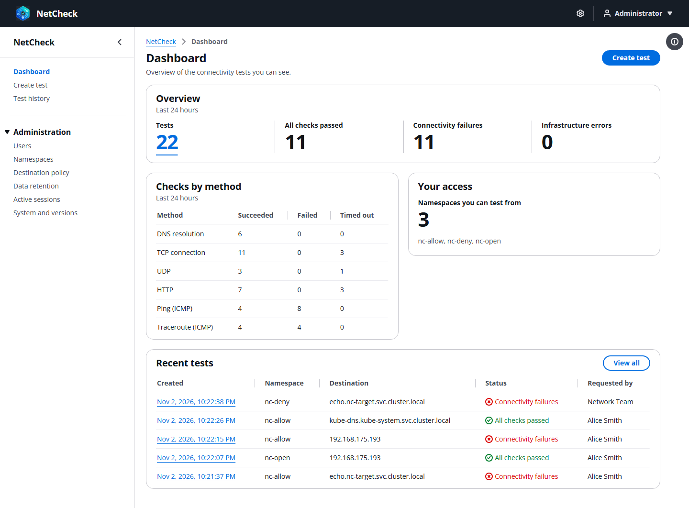

The interface is **in English by default**, whatever the browser language is. Each person can switch to Spanish on the
sign-in page (**Language** selector) or in **Preferences** (gear in the top bar or the user menu). The choice is stored
in their account, in the database, and applies in any browser.

## 3. User list

**Administration → Users** lists every account with its role, namespaces, how it signs in (**Password** for local
accounts, **SSO** for single sign-on), status and last sign-in. The search box
filters by username, name or namespace; the table can be sorted and paginated. The **NetCheck** label in the namespaces
column means the account can use the NetCheck namespace.

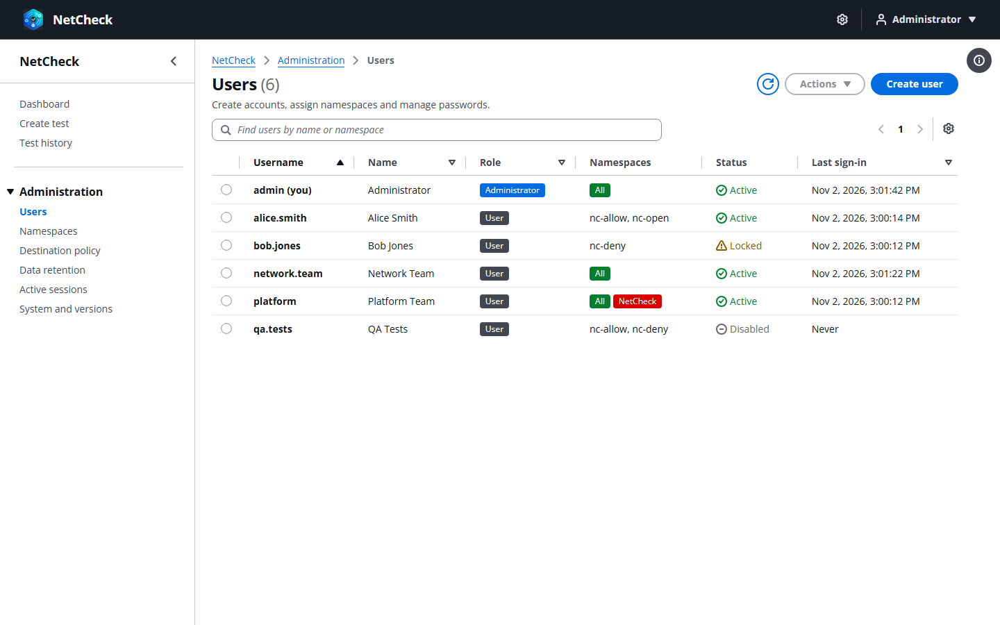

Statuses:

| Status | Meaning |
|---|---|
| Active | Can sign in |
| Temporary password | Must change the password at next sign-in |
| Locked | Too many failed attempts; unlocks by itself after 15 minutes or with **Unlock** |
| Disabled | Cannot sign in; their sessions were ended |

Single sign-on accounts appear the first time someone signs in with the identity provider. Their role and namespaces
come from the access rules (§16): editing one shows the groups of its last sign-in and only lets you enable or disable
it, and *Reset password* does not apply.

To act on an account, **select it** with the radio button on the left and open **Actions**:

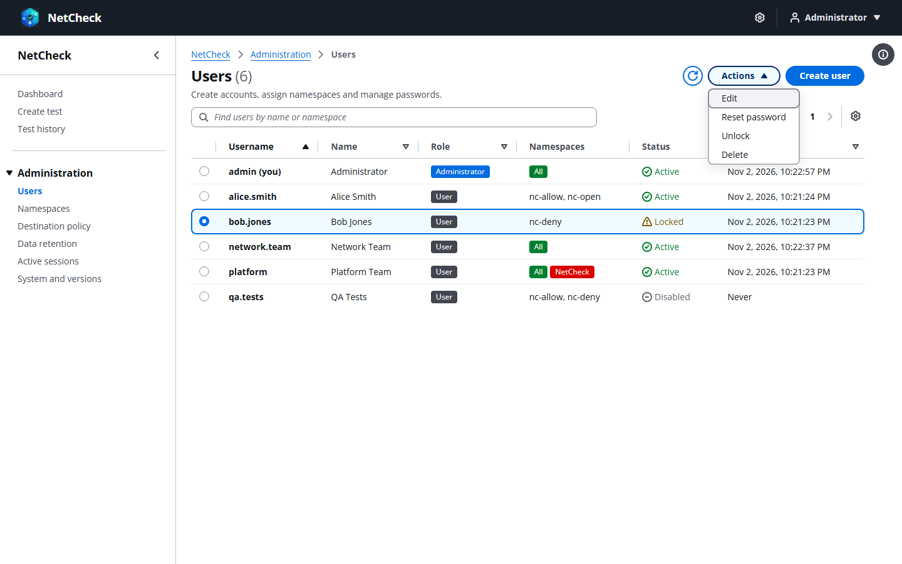

## 4. Creating a user

1. Click **Create user**.
2. **Username:** 3–64 characters: lowercase letters, digits, `.`, `_` or `-`. It cannot be changed later.
3. **Display name** (optional): shown in the history.
4. **Temporary password:** type one or click **Generate** and copy it with the icon. The user changes it at first
   sign-in. Share it through a secure channel, never in the same message as the username.
5. **Role:** *User* or *Administrator*.
6. **Namespaces** (for the User role):
   - **All namespaces:** **dynamic** access to every existing namespace and to those created later, except system
     namespaces, excluded namespaces and the NetCheck namespace. A new namespace shows up for the user in less than a
     minute.

     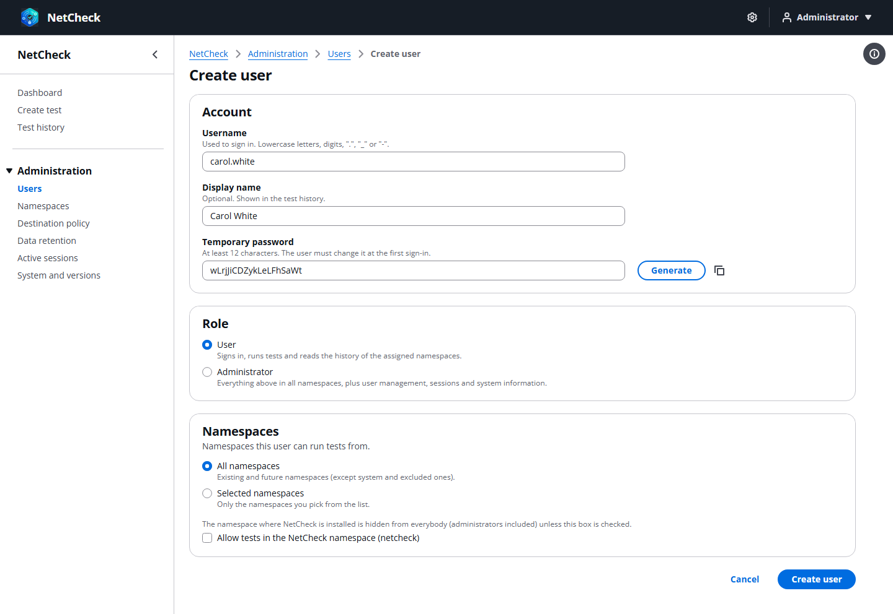

   - **Selected namespaces:** pick one or more from the list, read live from the cluster and searchable. The user only
     sees those namespaces, even if others are created later. The NetCheck namespace is not in this list.

     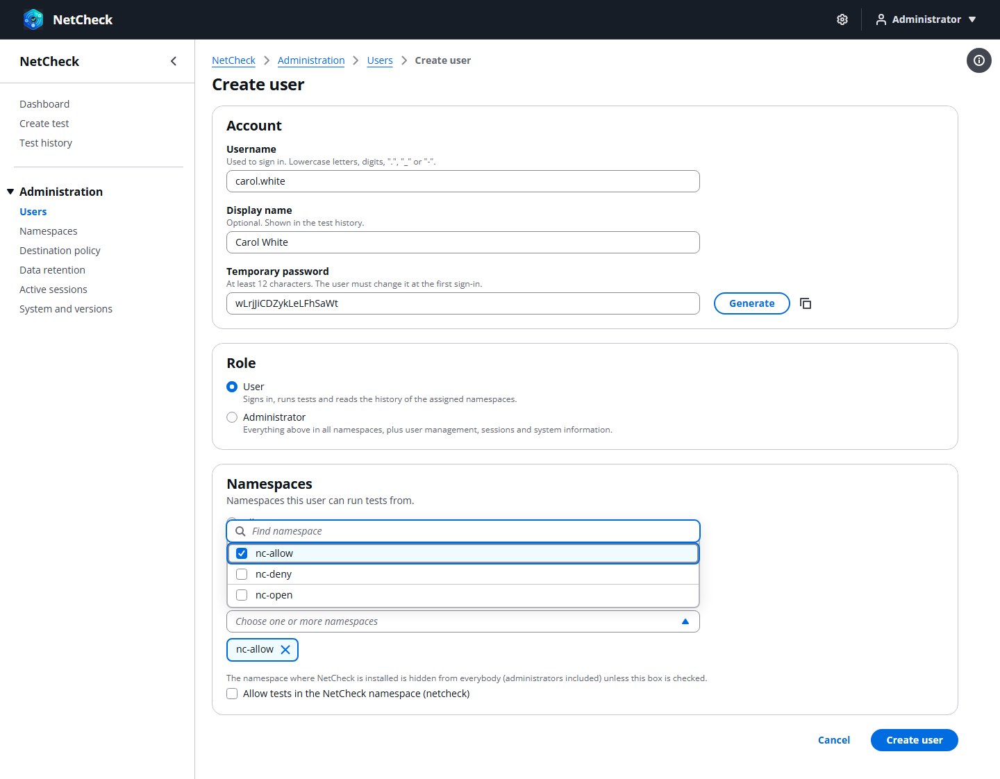

7. **Allow tests in the NetCheck namespace (`<namespace>`):** unchecked by default, available for both roles. Check it
   only for people who must troubleshoot NetCheck's own network (for example, the platform team). An account can have
   just this checkbox and no other namespaces.

   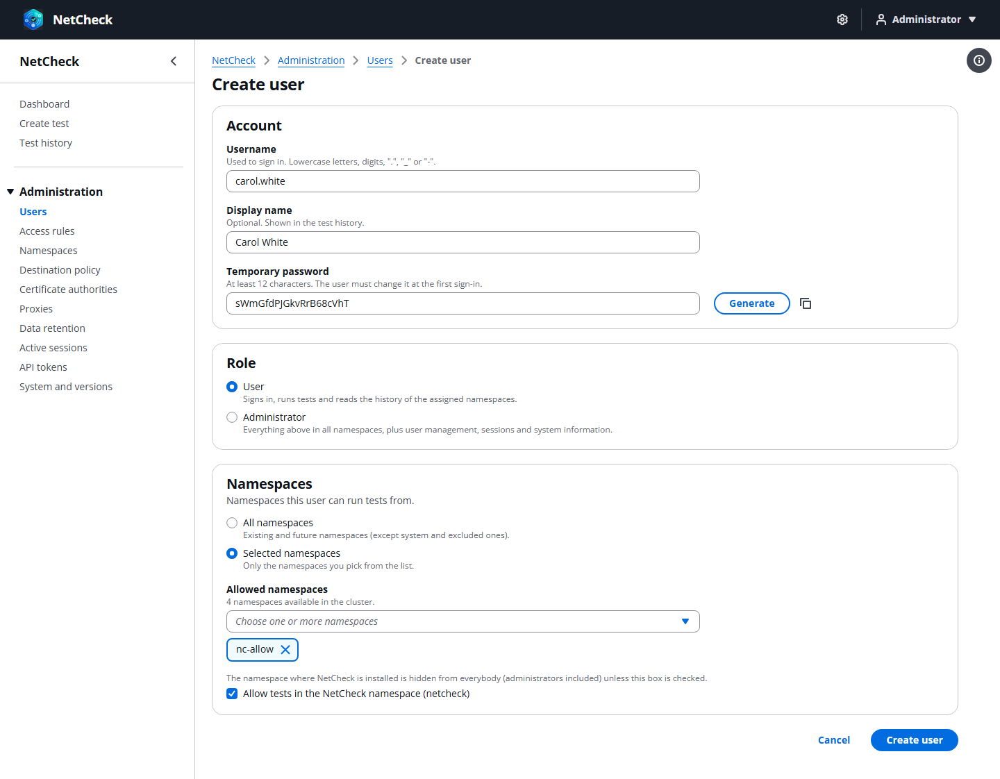

8. Click **Create user**. A notification confirms it:

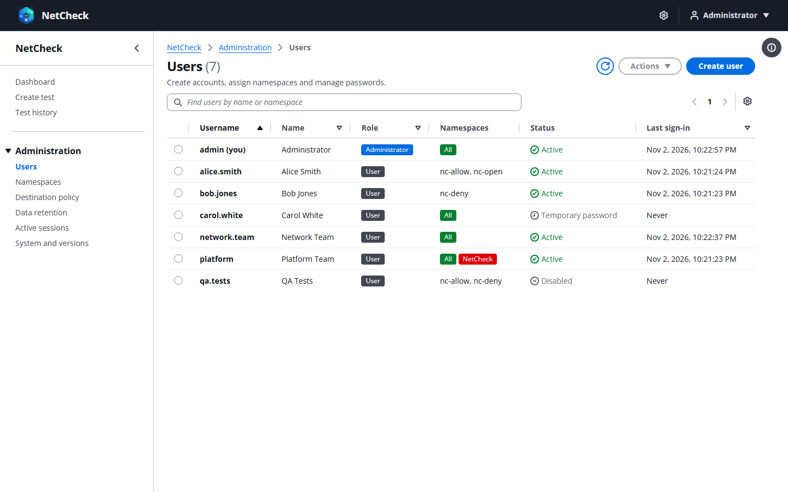

If the username already exists, the password is too short or no namespaces were selected, the form shows the error next
to the field.

## 5. Editing a user

**Actions → Edit** changes the display name, role, namespaces, the NetCheck namespace checkbox and the status (enabled
or disabled). Disabling an account ends all its sessions immediately.

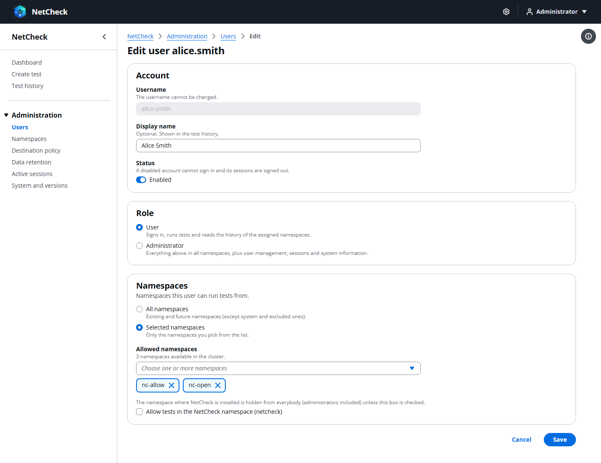

## 6. Resetting a password

**Actions → Reset password** generates a temporary password (you can type another one). On confirmation every session
of the user is ended and the user must change the password at next sign-in. It also clears a lock.

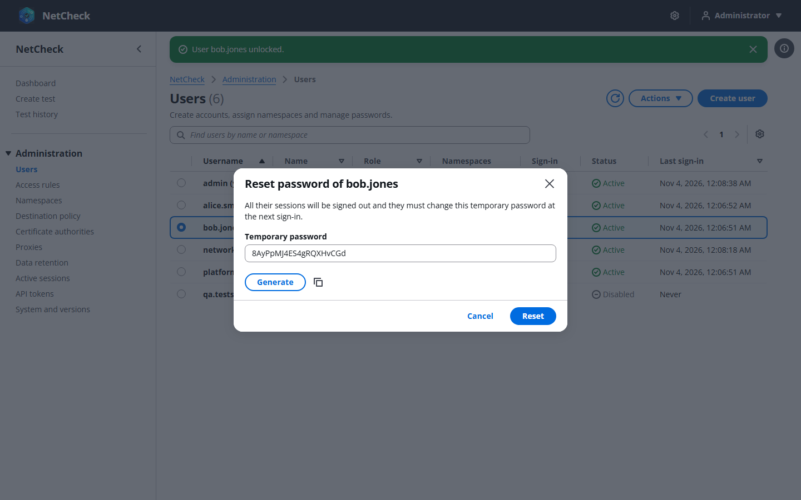

## 7. Unlocking

After 5 consecutive failed attempts the account is locked for 15 minutes (both values are configurable). **Actions →
Unlock** lifts the lock immediately. Sign-in error messages are always generic so they never reveal whether a user
exists.

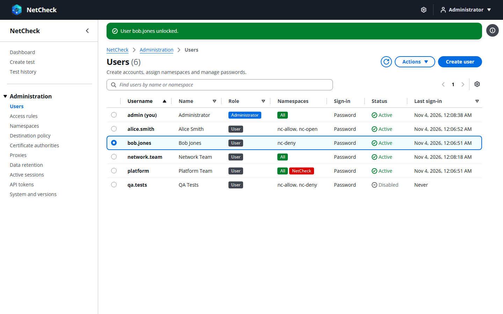

## 8. Deleting a user

**Actions → Delete** removes the account permanently, with its sessions, API tokens and personal proxies. The test
history it created is kept with its name. To block access only for a while, disable the account instead.

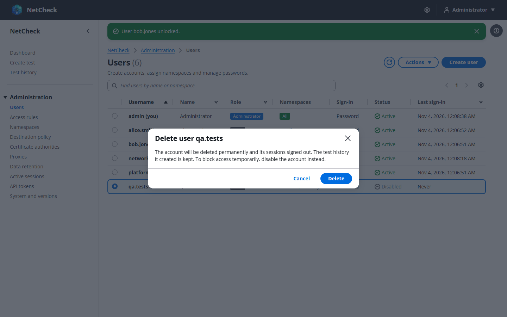

## 9. Active sessions

**Administration → Active sessions** shows how many **users are signed in** right now (distinct accounts with a session
that had activity within the idle timeout, 60 minutes by default), the number of sessions and, for each session, the
user, role, start time, last activity, client IP and browser.

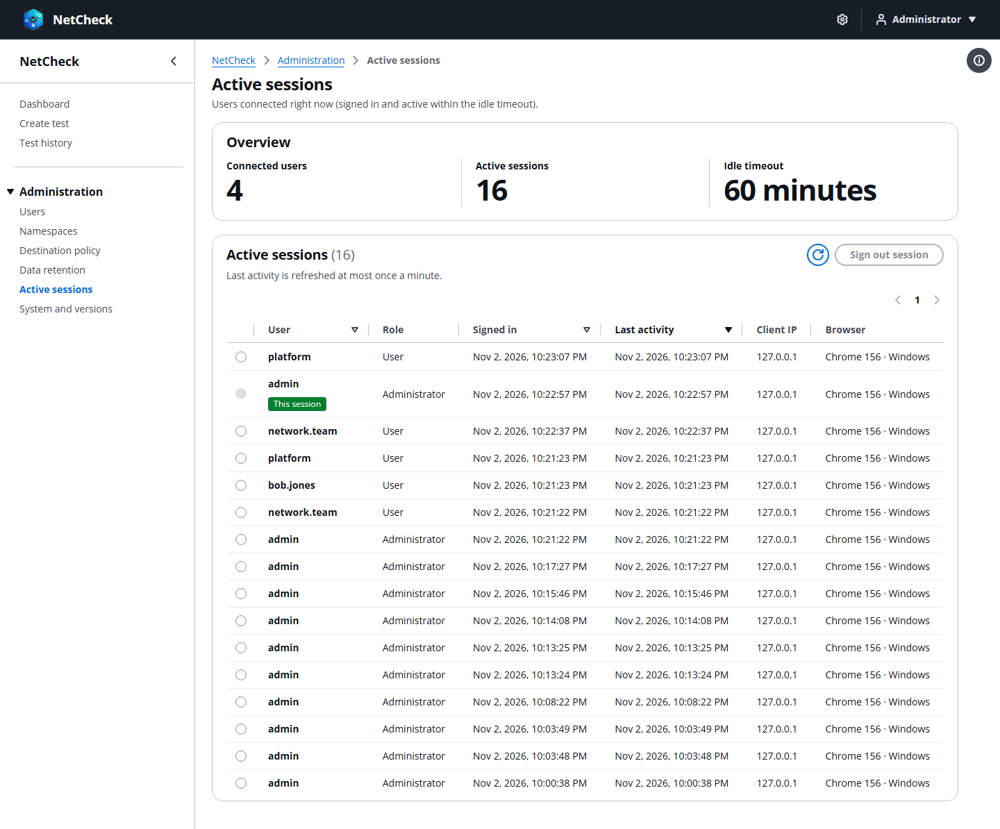

- Last activity is updated at most once per minute.
- Select a session and click **Sign out** to end it (for example, a shared computer left signed in). Your own session
  is marked **This session** and cannot be ended from here: use *Sign out* in the user menu.
- The client IP is the real one only if `auth.trustedProxyCidrs` contains the network of the Gateway or load balancer;
  otherwise you see the proxy IP.

## 10. Namespaces

**Administration → Namespaces** lists every namespace in the cluster (in `list` mode, the ones configured in Helm) and
whether tests can be run from it:

| Status | Meaning | Changeable from the web? |
|---|---|---|
| **Available** | Tests can run from it (depending on each user's namespaces) | Yes: **Exclude** |
| **Excluded in the web** | An administrator excluded it from this page; who, when and why are shown | Yes: **Include again** |
| **Excluded in Helm** | Listed in `namespaceScope.exclude` | No: `helm upgrade` |
| **System (always excluded)** | `default`, `kube-system`, `kube-public`, `kube-node-lease` | No, never |
| **NetCheck namespace** | Only for users with the matching checkbox (§4) | Per user, in their account |

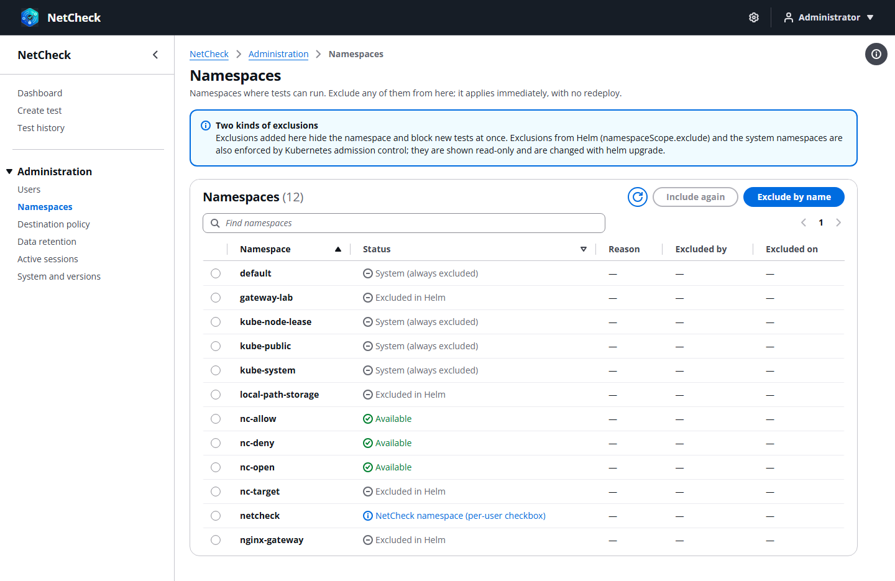

- **Exclude:** select an available namespace and click **Exclude**, or use **Exclude by name** for a namespace that
  does not exist yet (it is excluded as soon as it is created). You can add a reason.

  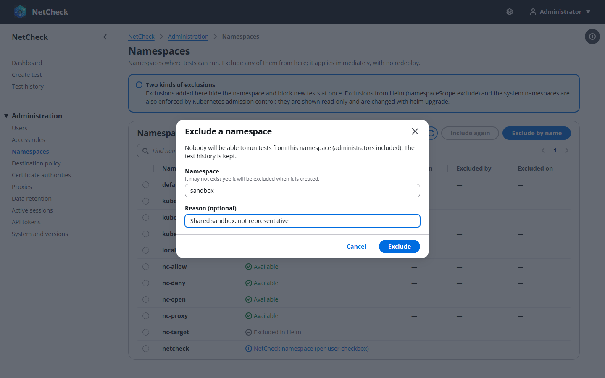

- **Immediate effect:** the namespace disappears from every user's list (administrators included) and the API rejects
  new tests from it. The history of earlier tests is kept.
- **Include again:** only for exclusions made in the web.
- Every change is audited (`namespace.exclude`, `namespace.include`).

**Why Helm exclusions cannot be removed here.** Helm and system exclusions are also enforced by Kubernetes admission
control (`ValidatingAdmissionPolicy`), which rejects any probe Job in those namespaces even if the application failed.
Removing them from the web would require NetCheck to have permission to change its own admission policies, which would
be a privilege escalation. The web can only **add** exclusions, which always restrict further.

## 11. Destination policy

**Administration → Destination policy** decides what users can test: names, networks and ports. Changes are stored in
the database and apply **to the next test**, without redeploying or restarting NetCheck. Every change is audited
(`policy.update`, with before and after) and the header shows who made the last one and when.

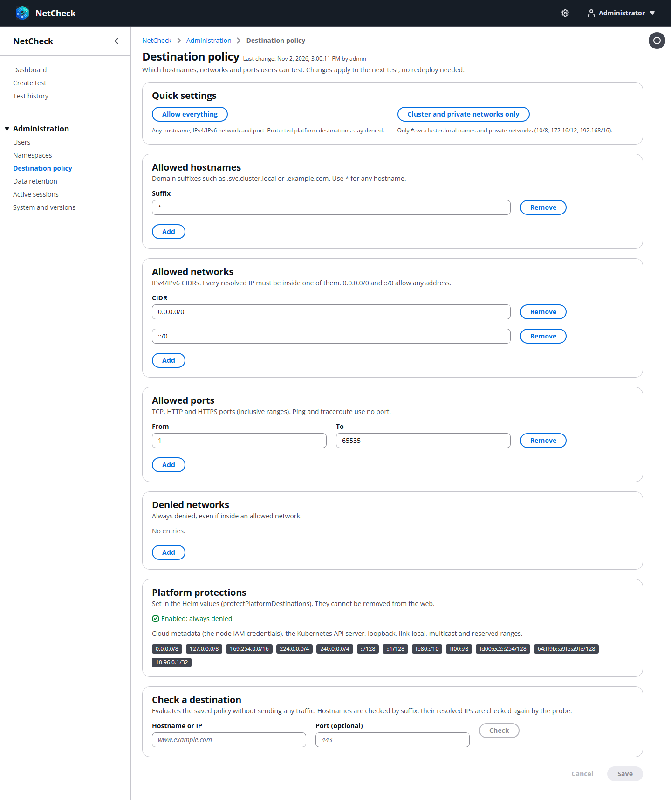

| Block | What it controls |
|---|---|
| **Presets** | *Allow everything* (any name, IPv4/IPv6 network and port) or *Cluster and private networks only* (`*.svc.cluster.local`, 10/8, 172.16/12, 192.168/16). They fill the form; nothing changes until you click **Save** |
| **Allowed names** | Domain suffixes (`.svc.cluster.local`, `.corp.example.com`). `*` allows any name |
| **Allowed networks** | IPv4/IPv6 CIDRs. Every resolved IP must be in one of them; `0.0.0.0/0` and `::/0` allow any address |
| **Allowed ports** | Ranges for TCP, UDP, HTTP and HTTPS. Ping and traceroute do not use a port |
| **Denied networks** | Always denied even inside an allowed network (for example a sensitive subnet) |
| **Platform protections** | Cloud metadata, the Kubernetes API server (its exact addresses, read from the cluster; see below), loopback, link-local, multicast and reserved ranges. Set in Helm (`protectPlatformDestinations`) and **cannot be removed from the web** |
| **Check a destination** | Tells whether a name or IP (and port) is allowed **without sending traffic** |

**The API server in the platform protections.** NetCheck denies the `kubernetes` Service IP, `kubeApiServerCidrs` and
the exact addresses the API server publishes in the EndpointSlice `default/kubernetes`, refreshed every 30 s (one Role
allows reading that object only). Until they are read, the ranges of `networkPolicy.apiServer.cidrs` are listed
instead: those ranges only let NetCheck reach the API server and are often whole subnets. If they still show up a
minute after the start, NetCheck cannot read the EndpointSlice: the Pod log says why (`cannot read the API server
addresses`), and every address in those ranges stays denied until it is fixed.

Example: restrict tests to internal services and a corporate domain. After **Save**, a destination such as
`www.google.com` is denied for new tests:

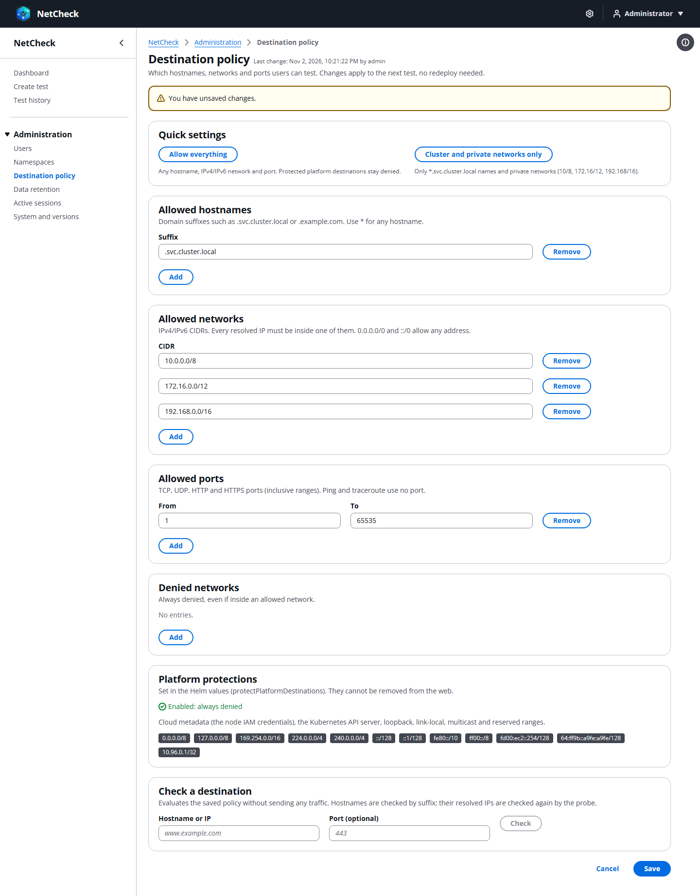

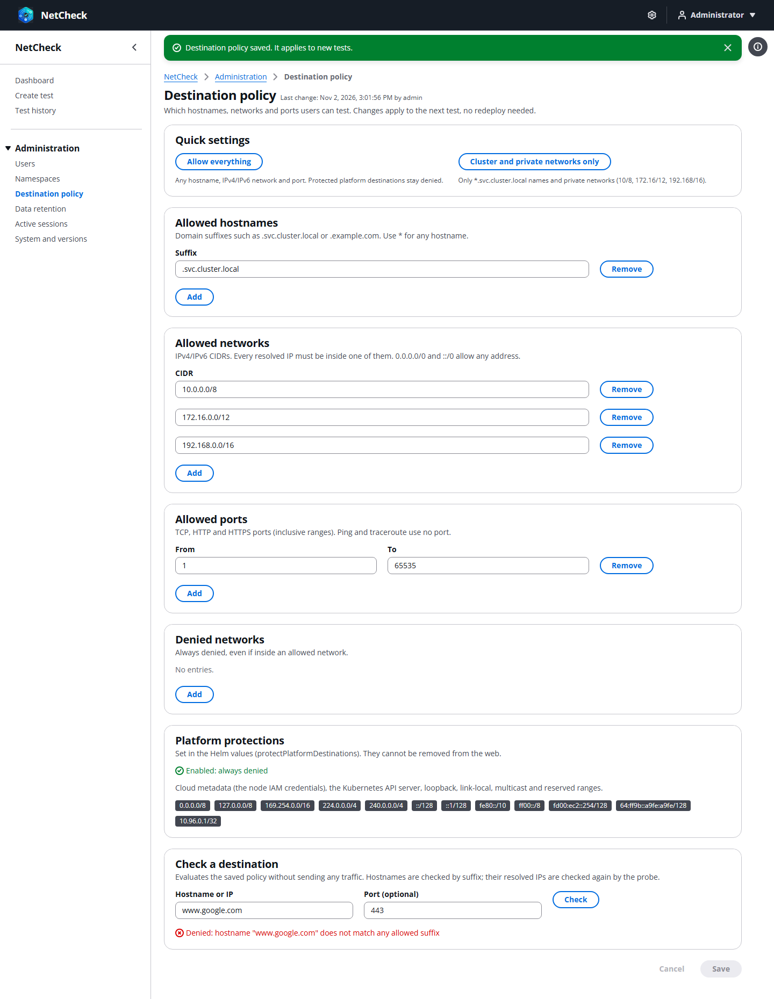

Notes:

- The chart's `destinations` values are only the **initial policy**: they are copied to the database on first start.
  After that, what you save here wins, even if you change the values (`destinationsManagedBy: ui`, the default).
- To manage the policy in Git with Helm, install with `destinationsManagedBy: helm`: the values are applied at every
  start and this page becomes **read-only**.
- For a name, the page checks the suffix; the probe checks the IPs it resolves to before connecting.
- Tests already running keep the policy they were created with.

## 12. Data retention

**Administration → Data retention** sets how long NetCheck keeps data. Changes are stored in the database, audited
(`retention.update`, with before and after) and applied within an hour, without redeploying.

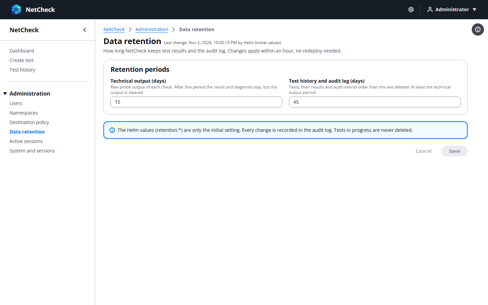

| Setting | What is deleted | Default |
|---|---|---|
| **Technical output (days)** | The raw probe output of each check. The result, diagnosis and timings stay | 15 |
| **Test history and audit log (days)** | Tests with all their results, and audit events | 45 |

- Each value is between 1 and 3650 days, and the history period must be at least the output period.
- Shortening a period deletes older data at the next hourly purge, and it cannot be recovered: the page warns before
  you save. Take a volume snapshot first if you may need that data (Part III §3).
- Tests that are queued or running are never deleted.
- The chart's `retention.outputDays` and `retention.metadataDays` are only the **initial** values, copied to the
  database on first start. After that, what you save here wins.


## 13. System and versions

**Administration → System and versions** shows:

- **Running version:** version, commit, build date, Helm chart version and the image references (with digest) of
  NetCheck and the probe.
- **Version history:** every combination of version, commit, image and chart that has ever started in this
  installation, with first seen, last start and number of starts. Useful to know what was deployed and when.
- **Platform settings:** cluster, namespace scope, NetCheck namespace, limits and policy settle time. They are set in
  the Helm values and changed with `helm upgrade`; this page is read-only.
- **Destination policy:** allowed networks, ports and suffixes and the status of the platform protections. **Edit
  policy** opens *Administration → Destination policy* (§11), where they can be changed without redeploying.
- **Data retention:** how long test output and history are kept. **Edit retention** opens *Administration → Data
  retention* (§12).

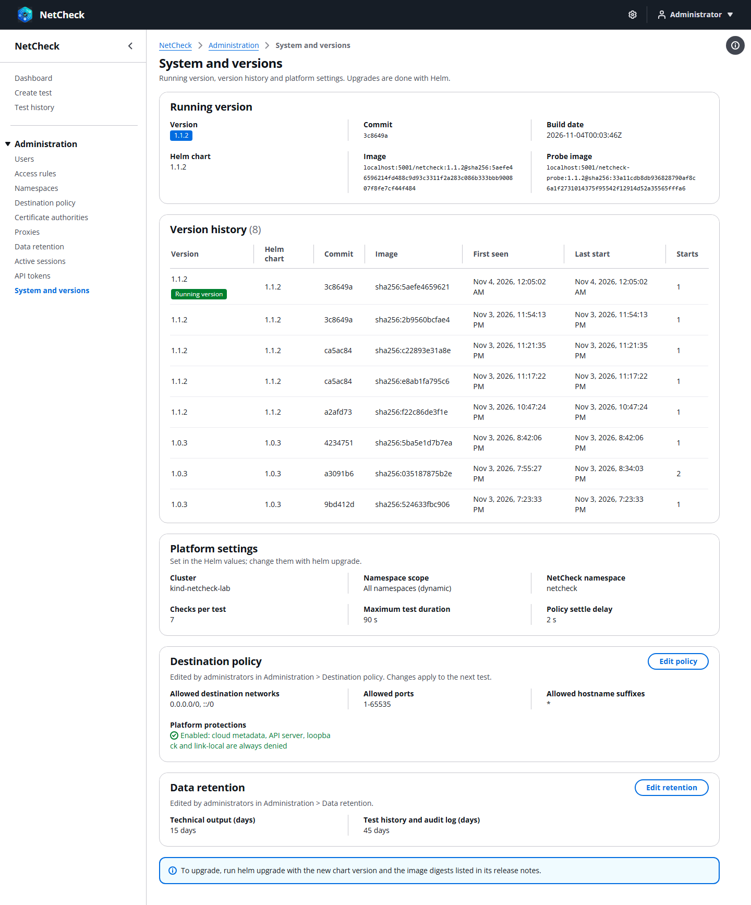

Upgrades are **not** done from the web: publish the new images and run `helm upgrade` (Part III, §1). That keeps the
change under the control of whoever operates the cluster and in your configuration repository.

## 14. Safety rules

- You cannot delete or disable yourself, remove your own administrator role, or end your own session from **Active
  sessions**.
- The **last** active administrator cannot be deleted, disabled or demoted.
- Changing or resetting a password ends that user's other sessions.
- There is no MFA. Mitigations: account lockout, per-IP rate limiting, mandatory TLS, mandatory change of the initial
  password and sign-in auditing. Put NetCheck behind your SSO proxy if you need MFA.

## 15. Full history

Administrators see in **Test history** the tests of every namespace and every user, with filters by namespace and
status. Other users only see the tests they started (from the web or with their API tokens), even in namespaces they
share with others: the namespaces assigned to a user decide where they may run tests, not whose results they see.
Two permissions of a custom role (§21) widen it: every test of its namespaces, or the tests of the people sharing a
group with them, only in their namespaces (§22).

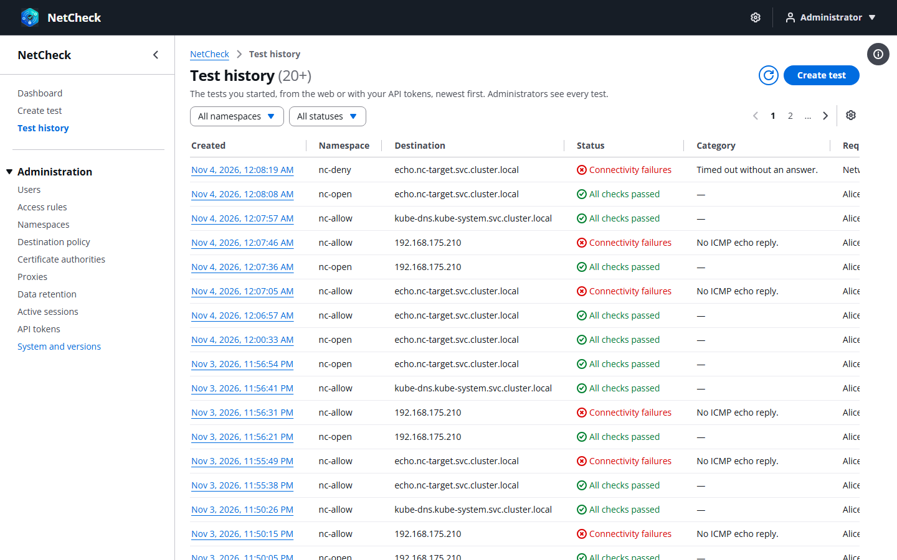

## 16. Access rules (single sign-on)

With single sign-on enabled ([sso.md](sso.md)), **Administration → Access rules** decides who can sign in with the
identity provider and with which permissions, **before** they sign in for the first time:

1. Click **Create rule**.
2. **Applies to:** a **Group** of the provider (for GitHub through Dex, `my-org:my-team`), one **User** (the username
   the provider sends, usually the e-mail or the GitHub login) or **Any authenticated user**.
3. Choose the **role** (User, Administrator or a custom role, §21) and, except for Administrator, the
   **namespaces** (a list or all, including future ones) and whether the NetCheck namespace is allowed. It is the same
   as for a local user.
4. **Save.** The rule applies at once to the existing SSO accounts.

A person gets every rule that matches, each with its own namespaces (§21, *Several roles*). Without a matching rule they cannot sign in with SSO, and an SSO
account left without rules by a change is signed out and loses its API tokens. The rules can be prepared before SSO
is enabled. Every change is in the audit log.

## 17. API tokens

Users create API tokens for pipelines and `netcheck-cli` in **My API tokens** (side navigation) or their **user
menu → API tokens** (see the [CLI guide](cli.md)). A token acts as its owner but can only run and read tests, expires after at most one year and
stops working when the account is disabled.

**Administration → API tokens** lists every token with its owner, creation, expiry and last use. Select one and
**Revoke** it when it is no longer needed or may have leaked: pipelines using it fail at once with an authentication
error. Expired tokens are deleted automatically. Creating and revoking tokens is audited (`token.create`,
`token.revoke`).

## 18. Certificate authorities

HTTPS checks verify certificates against the **public** authorities only. A server with a certificate from your
corporate PKI, or traffic that a firewall decrypts and re-signs on the way, is reported as *signed by an authority the
probe does not trust*. **Administration → Certificate authorities** adds authorities that **every** HTTPS check trusts
**on top of** the public ones, with or without a proxy. For the authority of a proxy you choose in the test, see
[Which one to use](#which-one-to-use) below: it belongs in the proxy, not here.

1. Click **Add certificates** and paste the authority in PEM, from `-----BEGIN CERTIFICATE-----` to
   `-----END CERTIFICATE-----`. A bundle with several certificates is split; duplicates are dropped.
2. Click **Add certificates** again to save. New tests use the list at once; there is nothing to redeploy and no custom
   image.

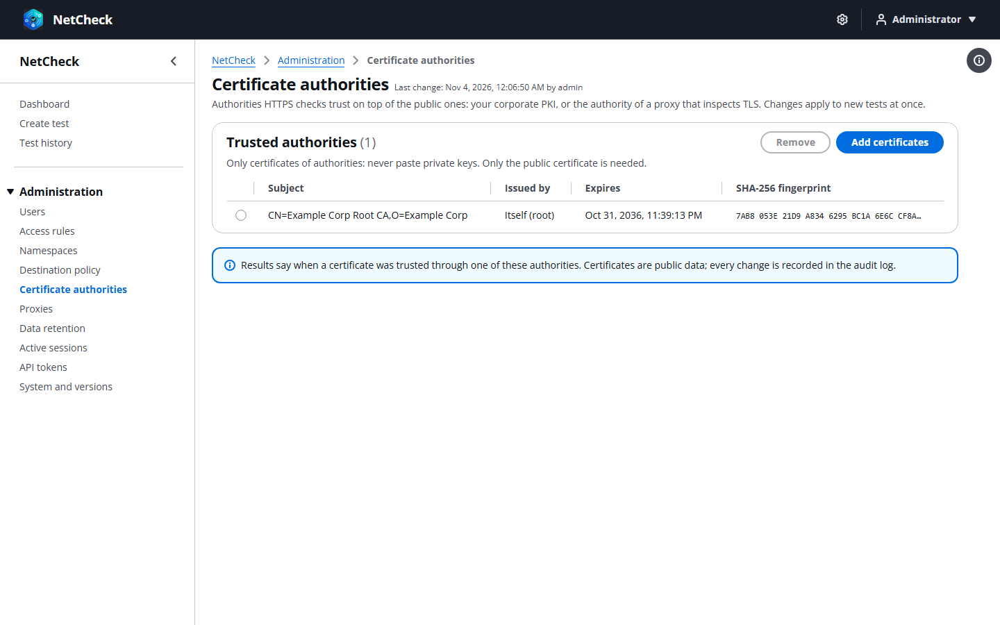

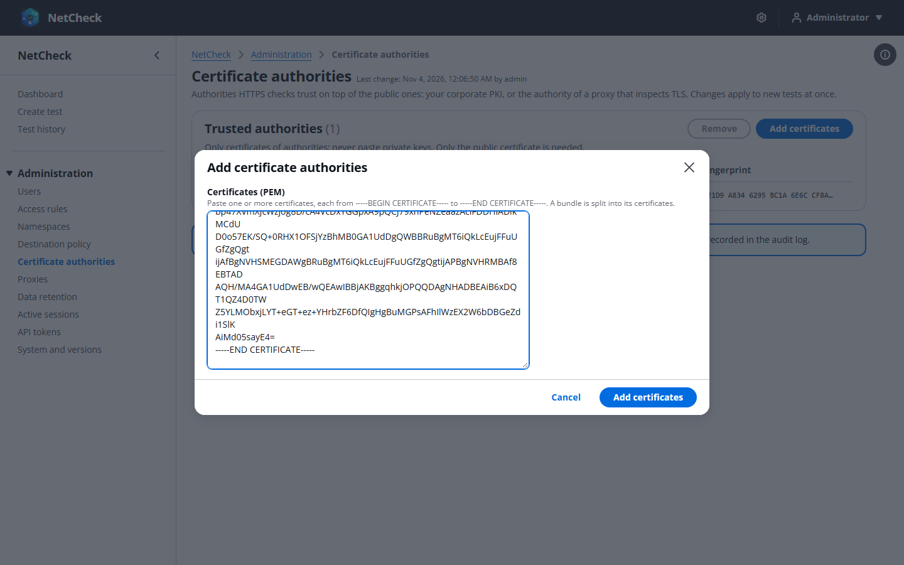

The list shows the subject, the issuer, the expiry (expired authorities are marked) and the SHA-256 fingerprint, to
compare with the one your PKI team gives you. Select an authority and **Remove** it to stop trusting it.

Only certificates of authorities are accepted: a server certificate (`CA:FALSE`), anything that is not PEM and any
private key are refused. At most 50 certificates and 64 KiB in total, because the list travels inside the
specification of every HTTPS test. Tests without an HTTPS check never receive it. Every change is in the audit log
(`trusted_cas.update`) with the subject and fingerprint of each certificate, never the PEM.

When a certificate was validated through one of these authorities, the result says so (**Trusted through: … (authority
configured in NetCheck, not a public one)**) and the equivalent command adds `--cacert`. If a public site such as
`www.google.com` shows up as trusted through your corporate authority, something on the path is inspecting TLS.

### Which one to use

NetCheck trusts a non-public authority in two places. Pick by **who issued the certificate the check receives**:

| Situation | Where the authority goes | Which checks trust it |
|---|---|---|
| Your servers have certificates from your **corporate PKI** (internal APIs, cert-manager with a private issuer) | **Certificate authorities** (this section) | Every HTTPS check of every user |
| A **firewall decrypts TLS transparently** on the path (inline inspection: nothing is configured as a proxy, the Pod connects "directly") | **Certificate authorities** (this section) | Every HTTPS check of every user |
| An **HTTP proxy that inspects TLS** and that users choose in **Connection** (Zscaler, Netskope, Squid with SSL bump…) | **The proxy** (§19, *Certificate authorities of this proxy*) | Only HTTPS checks **through that proxy**, by whoever may use it |

Keep the authority of an explicit proxy in the proxy, not here. Here it would also be trusted by checks that do **not**
go through the proxy, and an unexpected interception on a direct path would then look valid instead of being reported
as an untrusted authority.

A check through a proxy trusts **both lists**: these authorities plus the proxy's. So a check to an internal server with
a corporate certificate works through an inspecting proxy too.

**With Helm or Argo CD.** The initial list comes from `trustedCas` in the values (certificates are public data, safe in
Git). Like the destination policy, `trustedCasManagedBy: ui` (default) copies it to the database on the first start
and the web manages it afterwards; `trustedCasManagedBy: helm` makes the values authoritative and the page read-only:

```yaml
trustedCasManagedBy: helm
trustedCas:
  - |
    -----BEGIN CERTIFICATE-----
    ...
    -----END CERTIFICATE-----
```

## 19. Proxies

When your applications reach a destination through a corporate HTTP proxy, testing the direct path from the Pod
answers the wrong question. Checks can go through a proxy instead, always **optionally** and per check: **TCP, HTTP and
HTTPS** have a **Connection** choice, **Direct** by default. Without proxies the choice is hidden.

There are two kinds of proxies:

| | Shared proxies (administrators) | Personal proxies (each user) |
|---|---|---|
| Where | **Administration → Proxies** | **My proxies** (side navigation or user menu) |
| Who creates, edits and deletes them | Administrators only | Only their owner |
| Who sees and uses them | **Every user** (*Share with every user*) or **administrators only** | **Only their owner**, administrators included: nobody else |
| Limit | 20 | 10 per user; deleted with the account |

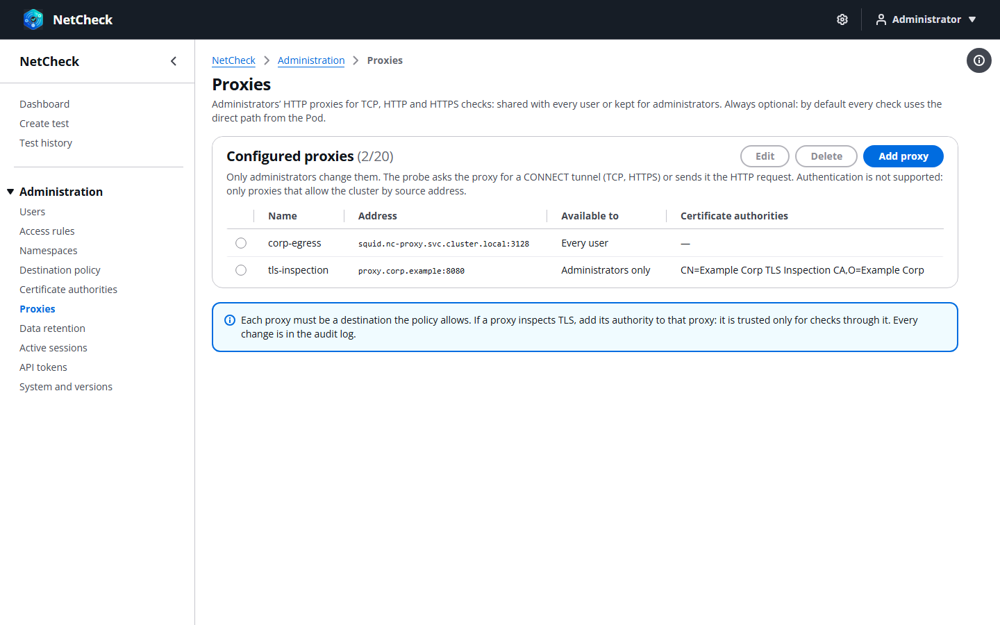

To add one, click **Add proxy** and give it a **name** (for example `corp`: lowercase letters, digits or dashes), the
**host name or IP** and the **port** (usually 3128 or 8080), and optionally the **certificate authorities of this
proxy** (see below). In a test, the user's own proxies are listed under **My proxies** and the shared ones under
**Shared**.

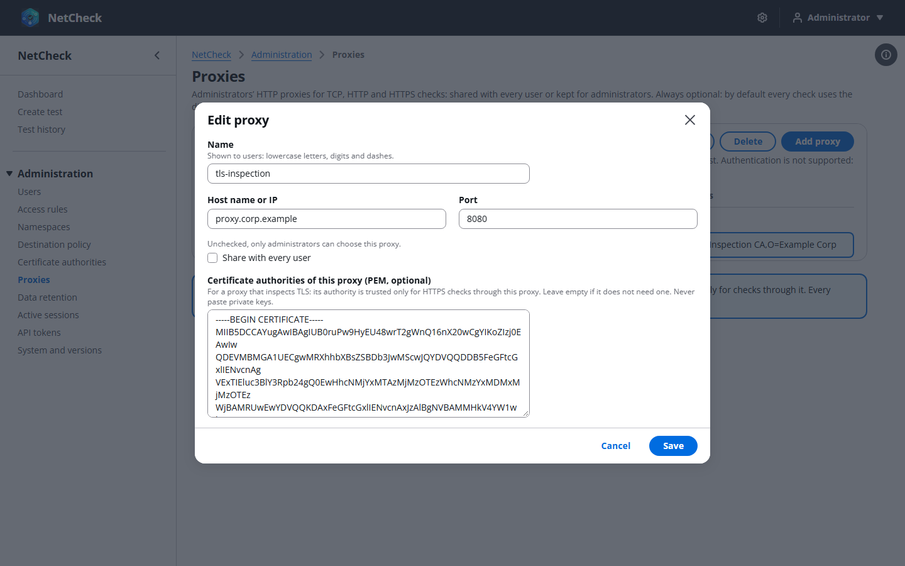

How a check goes through the proxy:

- **TCP and HTTPS:** the probe asks the proxy for a `CONNECT` tunnel to the destination; for HTTPS it then speaks TLS
  inside the tunnel, like `curl --proxy`.
- **HTTP:** the probe sends the request to the proxy with the full URL and the proxy forwards it, like `curl -x`.

The result shows the proxy, its IP and its answer, and tells apart where the problem is: the proxy **could not be
reached** from the Pod, it **refused** (403, its policy; many proxies only allow `CONNECT` to port 443), it **requires
authentication** (407), it **could not reach the destination** (502/503/504) or it **did not answer in time**. For
HTTP, an error page the proxy answers itself (Squid's `X-Squid-Error`, `Proxy-Status`) is a proxy result; any other
answer is the destination's.

**Certificate authorities of a proxy.** A proxy that inspects TLS re-signs every certificate with its own authority.
Paste that authority (PEM) in the proxy: it is trusted **only for HTTPS checks through that proxy**, and the result
says the certificate was trusted through it. A proxy that does not inspect TLS needs none. The authorities of
**Certificate authorities** (§18) apply to every HTTPS check, with or without a proxy; [which one to
use](#which-one-to-use) explains where each authority belongs.

The authorities **travel with the proxy**:

- **Shared proxy:** every user who may choose it (every user, or administrators only) trusts its authorities in their
  checks through it. They do not see the PEM: the **Connection** list only tags the proxy *with CA*. Only
  administrators see, change or remove the authorities.
- **Personal proxy:** only its owner trusts, sees and changes them.

**Privacy of personal proxies.** Each user only sees their own tests (§15). When an administrator opens a test that
went through a personal proxy, it shows **"Personal proxy of \<user\>"**: the name, address, IPs and authorities of the
proxy are hidden from the result, the output and the equivalent command. The audit log keeps who created, changed or
deleted each proxy, with its name, address and the subject and fingerprint of its authorities (never the PEM).

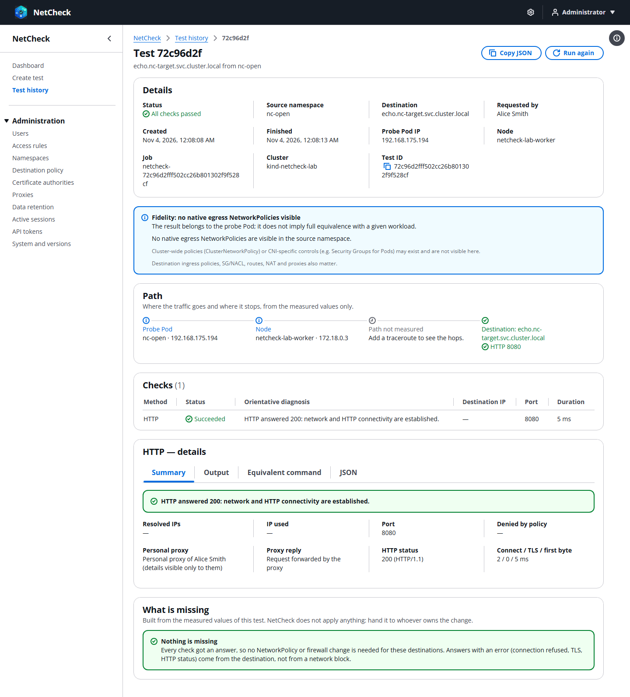

Rules and limits:

- Each proxy, shared or personal, must be a **destination the policy allows** (its address and port), checked when it
  is saved and on every test. It needs an egress NetworkPolicy from the source namespace like any destination.
- The proxy, not the probe, resolves and connects to the destination, so the destination is checked by name and port
  only. Keep the destination policy in mind: a user's own proxy can reach whatever that proxy reaches.
- **No authentication:** the probe never carries credentials. Use proxies that allow the cluster by source address.
- DNS, UDP, ping, traceroute and the firewall ticket always use the direct path.
- Changes are audited (`proxies.create`, `proxies.update`, `proxies.delete`).

**With Helm or Argo CD:** `proxies` in the values is the initial list of shared proxies, managed in the web afterwards
(`proxiesManagedBy: ui`, default), or authoritative with `proxiesManagedBy: helm` (then **Administration → Proxies**
is read-only). Personal proxies are always managed in the web:

```yaml
proxies:
  - name: corp
    host: proxy.example.com
    port: 3128
    shared: true        # false: administrators only
    trustedCas: []      # PEM authorities trusted only through this proxy
```

## 20. Check types

**Administration → Check types** switches each kind of test on or off for **everybody, administrators included**:
DNS, TCP (telnet), UDP, HTTP, HTTPS, ping, traceroute, and the **firewall ticket** mode. Everything is on by default.
Use it when your organisation does not want a kind of test at all, for example no traceroute or no UDP.

1. Switch off the types you do not want. The page warns about unsaved changes.
2. Click **Save**. It applies to new tests at once: there is nothing to redeploy.

What happens with a disabled type:

- It **disappears from the new-test form**. **Run again** of an older test leaves it out and says so.
- The **API, `netcheck-cli` and API tokens** refuse it with `403 check_type_disabled`, naming the check. The CLI exits
  with code 3.
- **Firewall ticket:** switching off the mode removes it from the form. Switching off some of its checks (for example
  ping and traceroute) leaves them out of the ticket, and the report says `not run (disabled by an administrator)`
  for each.
- Tests already run keep their results.

At least one check must stay enabled. Every change is in the audit log (`check_types.update`) with the types disabled
before and after.

**With Helm or Argo CD.** `checkTypes.disabled` in the values is the initial setting; like the other settings,
`checkTypesManagedBy: ui` (default) copies it to the database on the first start and the web manages it afterwards,
and `checkTypesManagedBy: helm` makes the values authoritative and the page read-only:

```yaml
checkTypesManagedBy: helm
checkTypes:
  disabled: [traceroute, udp]   # dns, tcp, udp, http, https, ping, traceroute, firewall
```

## 21. Roles

**Administration → Roles** defines what each role allows. **User** and **Administrator** are built in and cannot be
changed. A **custom role** chooses, one by one:

| Group | Permissions |
|---|---|
| Checks | DNS, TCP, UDP, HTTP, HTTPS, ping, traceroute, and the firewall ticket |
| Tests it sees | Every test of its namespaces, or the tests of the people sharing a group (§22); otherwise only its own |
| Proxies | Use the shared proxies; have personal proxies (**My proxies**) |
| Command line | Create API tokens |
| Administration | Destination policy, certificate authorities, shared proxies, check types, namespaces (exclusions), data retention, active sessions (see and end), everybody's API tokens (see and revoke), system and versions |

The built-in **User** has every permission except seeing other people's tests and the administration.

**Delegating administration.** A custom role with administration permissions sees, in **Administration**, only those
pages, for example a *Network team* role with the destination policy and the shared proxies. **Users, groups, roles and
access rules always stay with Administrator**: whoever manages them could give themselves any permission. Keep in mind
what each part allows: the destination policy decides what can be tested, active sessions can sign out anybody
(administrators included) and API tokens can be revoked for anybody.

1. Click **Create role**, give it a name (for example *Network on-call*) and an optional description, and tick its
   permissions. **Save**: it applies at once.
2. Give it to a person in **Users → Edit → Role**, to a local group in **Groups** (§22), or to a group of the identity
   provider in **Access rules** (§16), each with its namespaces.

A role given to someone (users or access rules) cannot be deleted: the list says to how many. Every change is in the
audit log (`role.create`, `role.update`, `role.delete`).

**Several roles.** A person can have several roles, for example through several access rules. In **each namespace**
they get the permissions of the roles given **for that namespace** only: "Network on-call in `orders`" plus "User in
`payments`" allows only the on-call checks in `orders`. The check types switched off in **Check types** (§20) stay
off whatever the role.

**Effective permissions.** **Users → Edit** shows what the person can do now: their roles and **where each one comes
from** (the account itself or an access rule), the checks allowed in each namespace and the other permissions. Use it
to answer "why can't I…?".

What a user sees when the role does not allow something: the new-test form only offers the checks allowed in the
chosen namespace and says which ones it removed; the API, `netcheck-cli` and API tokens answer `403
check_not_allowed` naming the check; **My proxies** and the token creation are hidden without their permission.

Roles are managed only in the web (not in the Helm values).

## 22. Groups

**Administration → Groups** gives a role with its namespaces to several people at once, for example a team:

1. Click **Create group** and give it a name (for example *Payments team*) and an optional description.
2. Choose the **members**: local accounts, or single sign-on accounts that already signed in once.
3. Choose the **role** (User, Administrator or a custom role, §21) and, except for Administrator, its **namespaces**.
4. **Save.** It applies at once.

Members keep their own role and namespaces and get the group's **on top**, in the group's namespaces only, like any
other role (§21, *Several roles*). Leaving the group removes what it gave. For the groups of your identity provider,
use **Access rules** (§16) instead: they apply without adding anybody by hand.

**Administrators through a group.** A group with the Administrator role makes its members administrators. NetCheck
always keeps at least one enabled administrator, counting those of groups, and **nobody can take away their own
administrator role**, by changing their account, changing a group or leaving it (`self_admin`).

**Seeing the tests of the group.** A role with **The tests of the people sharing a group** lets its holders see, besides
their own tests, those of the people who share a group with them (a local group or a group of the identity provider),
only in the namespaces they can use themselves. Personal proxies stay private: the others see *Personal proxy of …*.

Every change is in the audit log (`group.create`, `group.update`, `group.delete`, with the members). The effective
permissions of a user (§21) name each group they get something from.

---

# Part III — Operations

## 1. Upgrading

<!-- x-release-please-start-version -->
```bash
helm upgrade netcheck oci://ghcr.io/hgeorge123/charts/netcheck --version 1.3.1 \
  -n netcheck -f values.yaml --wait --timeout 10m
```
<!-- x-release-please-end -->

The command names the latest release; check [CHANGELOG.md](../CHANGELOG.md) before upgrading, and use an earlier
version number to roll forward one step at a time. Each chart version already points to the images of its release by
digest, so no image values are needed (unless
you use a mirror: then keep its repositories in `values.yaml`). Always pass `-f values.yaml` (or
`--reset-then-reuse-values`); do not use `--reuse-values`, which ignores new chart defaults. Database migrations run by
themselves at startup. Check the result in **Administration → System and versions**: the new version shows as *Running
version* and is added to the history. During the restart (`Recreate` strategy) the tool is unavailable for a few
seconds; tests in progress are recovered or marked as infrastructure errors.

## 2. Changing the configuration

Edit `values.yaml` (exclusions, limits, `settleSeconds`…) and run `helm upgrade`. The Pod restarts with the
new configuration, which is validated at startup; if it is invalid the Pod does not start and the log explains why.

## 3. Backups

All the data (users, history and audit) lives in the `netcheck-data` volume.

- **Scheduled volume snapshots (recommended):** use your storage snapshots (`VolumeSnapshot`) or, on AWS, AWS Backup or
  Amazon Data Lifecycle Manager. On EKS, get the EBS volume ID with
  `kubectl get pv $(kubectl -n netcheck get pvc netcheck-data -o jsonpath='{.spec.volumeName}') -o jsonpath='{.spec.csi.volumeHandle}'`.
  A block snapshot is crash-consistent and includes the SQLite WAL, which is replayed when the database opens.
- **Cold copy (maximum consistency):** `kubectl -n netcheck scale deploy/netcheck --replicas=0`, take the snapshot and
  scale back to `--replicas=1`.

**Restore:** create a volume or PVC from the snapshot, in the same availability zone, and install with
`--set persistence.existingClaim=<pvc-name>`.

## 4. Retention

By default test output is deleted after 15 days and test history and audit after 45 days. Administrators change both
periods in **Administration → Data retention** (Part II §12); the purge runs every hour. Expired sessions are purged
every hour.

## 5. Recovering administrator access

If nobody can sign in as administrator (forgotten password, locked or disabled account):

<!-- x-release-please-start-version -->
```bash
# 1. Enable recovery: the initial admin goes back to the password in the Secret
helm upgrade netcheck oci://ghcr.io/hgeorge123/charts/netcheck --version 1.3.1 -n netcheck -f values.yaml \
  --set auth.bootstrapAdmin.recoverOnStart=true --wait
kubectl -n netcheck get secret netcheck-bootstrap-admin -o jsonpath='{.data.password}' | base64 -d; echo
# 2. Sign in as admin and change the password (mandatory)
# 3. Disable recovery straight away
helm upgrade netcheck oci://ghcr.io/hgeorge123/charts/netcheck --version 1.3.1 -n netcheck -f values.yaml --wait
```
<!-- x-release-please-end -->

Recovery is recorded in the audit log (`user.recovery`) and in the Pod log. Only people with administrative access to
the cluster can do it.

## 6. Audit and logs

- **Audit** (`audit_events` table in SQLite): successful and failed sign-ins, sign-outs, password changes, user
  creation, deletion, changes, unlocks and recovery, ended sessions, API tokens, access rules, tests started or
  rejected, destination policy, retention and namespace changes, trusted certificate authorities (subject and
  fingerprint), shared and personal proxies (name and address), check types switched on or off, roles and local
  groups (with their permissions and members), and probe security events. It never contains passwords, tokens or certificate PEM.
- **Logs** of the Pod in JSON, with a `request_id` on every request: `kubectl -n netcheck logs deploy/netcheck`.
- **Log level** (`logLevel` in the chart values, `info` by default), validated at startup:

  | Level | What the log contains |
  |---|---|
  | `debug` | Everything in `info`, plus internal retries while following a test Job. Only for troubleshooting |
  | `info` | Startup and version, every HTTP request (load balancer health checks included), every test Job, purges and administrator changes, plus `warn` and `error` |
  | `warn` | Only problems that do not stop the service, and errors. Much less volume |
  | `error` | Only failures |

  Change it with `helm upgrade ... --set logLevel=warn` (or in your values file); the Pod restarts with the new level.
- There is no audit viewer in the interface yet. To query it, restore a snapshot and open the file with `sqlite3`.

## 7. Uninstalling

```bash
helm uninstall netcheck -n netcheck
# Kept on purpose (data and credentials): delete them only if you are sure
kubectl -n netcheck delete pvc netcheck-data
kubectl -n netcheck delete secret netcheck-bootstrap-admin
kubectl delete storageclass netcheck-gp3            # only if the chart created it
# Probe ServiceAccounts created on demand in "all" mode
kubectl delete serviceaccount -A -l app.kubernetes.io/managed-by=netcheck-controller
kubectl delete namespace netcheck
```

With `reclaimPolicy: Retain` the underlying disk still exists after the PVC is deleted: remove it in your cloud
provider if you no longer need it.

## 8. Troubleshooting

| Symptom | Likely cause | What to do |
|---|---|---|
| Pod and PVC `Pending` | No CSI driver or StorageClass, or the driver lacks cloud permissions | `kubectl -n netcheck describe pvc netcheck-data` |
| Pod `Pending` with `volume node affinity conflict` | No nodes in the zone of the volume | Add capacity in that zone, or restore the snapshot in another zone |
| Pod `ImagePullBackOff` | Nodes cannot reach the registry, Docker Hub rate limits, or a wrong digest | Check egress to Docker Hub (or your mirror) and the digests |
| Pod `CrashLoopBackOff` | Invalid configuration | `kubectl -n netcheck logs deploy/netcheck --previous` says which value fails |
| The web does not load; HTTPRoute `Accepted=False` | The listener `allowedRoutes` does not admit the namespace, or wrong `sectionName` | `kubectl -n netcheck describe httproute netcheck` |
| The web does not load with an Ingress; no address | Ingress controller missing, without permissions, or (ALB) untagged subnets | `kubectl -n netcheck describe ingress netcheck` |
| Load balancer answers 502/503 | Unhealthy target (firewall from the load balancer to Pod:8080, or Pod not ready) | On AWS: `aws elbv2 describe-target-health` |
| The web answers 502/504 | With the optional NetworkPolicy enabled: it does not admit the Gateway or the load balancer | Adjust `networkPolicy.gatewayNamespaces` or `networkPolicy.loadBalancerCidrs` |
| Every test ends in "Infrastructure error" | No access to the API server (optional NetworkPolicy misconfigured or a platform *default deny*) | Check `networkPolicy.apiServer.cidrs` and the logs |
| Ping/traceroute: "ICMP is not allowed inside the probe" | The node does not support the `net.ipv4.ping_group_range` sysctl, or an external admission policy (Kyverno, Gatekeeper) blocks it | Kubernetes ≥ 1.30 allows it as a safe sysctl; review those policies |
| Ping "no reply" but TCP succeeds | ICMP filtered by NetworkPolicies, security groups or firewalls | Expected; not a NetCheck failure |
| "Not allowed by the destination policy" | Metadata, API server, loopback or link-local (always protected), or the destination policy restricts it | The message gives the exact reason; check **Administration → Destination policy** |
| "Namespace … has no room for the probe Pod" | A ResourceQuota or LimitRange of the source namespace; the message names it and gives the numbers. No Job was created | The namespace owner raises the quota or frees resources. The probe needs 50m CPU and 32Mi memory (requests), 200m and 64Mi (limits), 16Mi of ephemeral storage, one Pod and one Job |
| "The Job did not create any Pod" | Pod Security, an admission webhook (Kyverno, Gatekeeper) or a quota NetCheck cannot evaluate (scope selectors) | `kubectl -n <ns> describe job` |
| "The netcheck-probe ServiceAccount has the IRSA annotation" | Someone attached a cloud IAM role to the probe | Remove the annotation or association; the probe must have no credentials |
| A new namespace does not show up | 30-second cache, or the namespace is excluded | Wait a minute; check **Administration → Namespaces** |
| The NetCheck namespace does not show up | Hidden by design | Check "Allow tests in the NetCheck namespace" for that user |
| The initial `admin` password from the Secret is refused; the Pod log says *the bootstrap admin still has a temporary password that is not the one in the bootstrap Secret* | The Secret changed after the admin was created. Typical with Argo CD or `helm template`: without cluster access the chart cannot see the Secret and generates a new password on every sync | Recover access and set `auth.bootstrapAdmin.existingSecret` so the password stops changing: [install.md §14.5](install.md#145-an-installation-that-already-has-the-problem) |
| Many `429` at sign-in | Per-IP rate limit, or `trustedProxyCidrs` is wrong (every user shares the Gateway IP) | Put the Gateway Pod CIDR in `auth.trustedProxyCidrs` |

## 9. Known limitations

- **No high availability:** one replica on a single-zone volume; the Pod always starts in that zone. If the zone goes
  down, restore from a snapshot in another zone.
- The result belongs to the **probe Pod**, not to a specific workload. Keep in mind security groups for Pods,
  `ClusterNetworkPolicy` and ingress policies on the destination side (see the fidelity notice).
- **Nodes without NetworkPolicy enforcement** (for example AWS Fargate or Windows nodes with the VPC CNI): do not run
  tests from those namespaces, the result would not reflect your policies.
- **No built-in MFA.**
