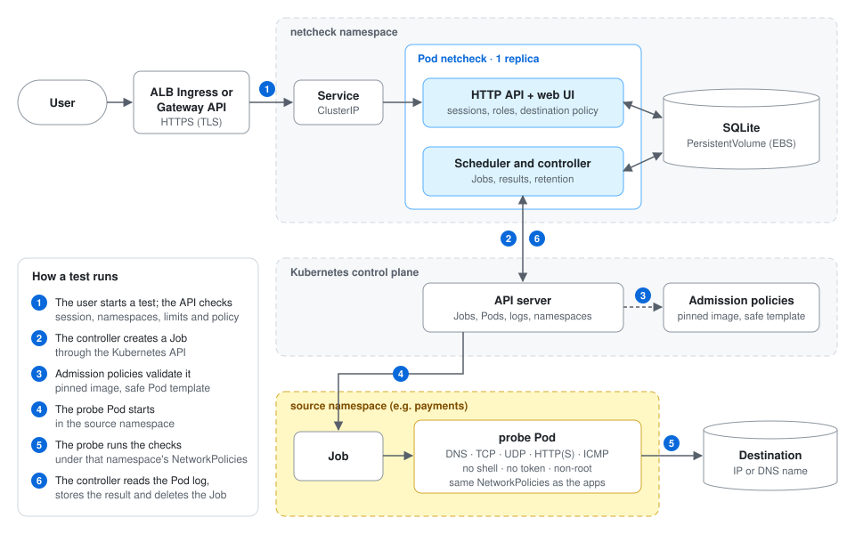
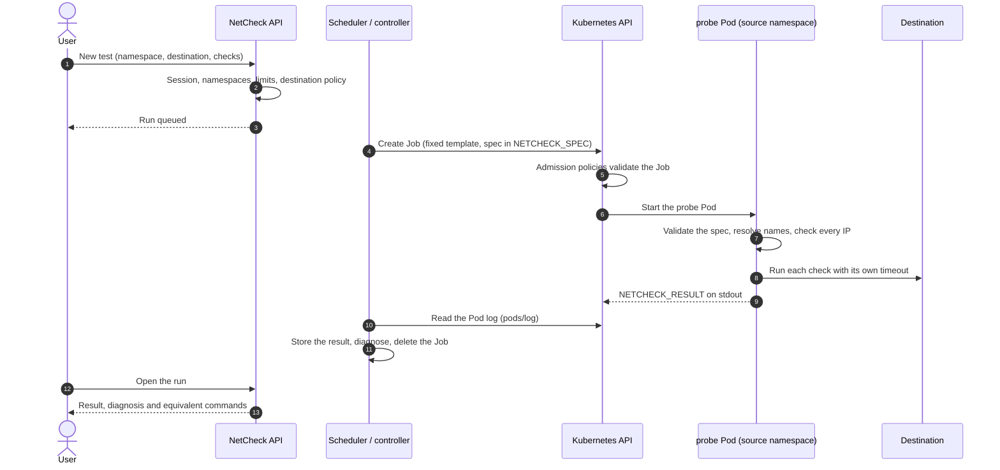

# Architecture

## Components

| Component | Code | Notes |
|---|---|---|
| Application binary | [cmd/netcheck](../cmd/netcheck) | One Go binary: REST API, static UI, scheduler and Kubernetes controller |
| Probe binary | [cmd/probe](../cmd/probe), [internal/probes](../internal/probes) | Static Go binary in its own image, no shell |
| Web interface | [web](../web) | React 18, TypeScript and Cloudscape; English and Spanish |
| Persistence | [internal/store](../internal/store) | SQLite (`modernc.org/sqlite`, no CGO), embedded versioned migrations |
| Kubernetes access | [internal/k8s](../internal/k8s) | client-go: Jobs, Pods, logs, namespaces, NetworkPolicies (read only) |
| Helm chart | [chart/netcheck](../chart/netcheck) | Values validation, preflight checks, RBAC, admission policies |

NetCheck runs as **one replica** with the `Recreate` strategy, because SQLite lives on a `ReadWriteOnce` volume.

## Life of a test

1. **Request.** The user submits a source namespace, a destination (IP or DNS name) and a list of checks, each with its
   own port and options. The API checks the session, the user's namespaces, the limits and the destination policy
   (syntax, suffix, literal IPs and ports).
2. **Queue.** The run is stored as `queued`. The scheduler enforces the concurrency limits per namespace and in total.
3. **Job.** The controller makes sure the `netcheck-probe` ServiceAccount exists in the source namespace (in `all`
   mode) and creates a Job from a fixed template. The test specification travels as JSON in the `NETCHECK_SPEC`
   environment variable. One Job runs all the checks of a test in sequence, so they share one network identity (IP,
   node, labels).
4. **Probe.** After `settleSeconds`, the probe validates the specification again, resolves names from the source
   namespace, checks every resolved IP against the policy and runs each check with its own timeout. It writes a human
   trace to stderr and, as the last line of stdout, `NETCHECK_RESULT <json>` with `schemaVersion: netcheck.probe/v2`.
   Exit code `0` means the probe ran every check, whatever the network outcome; anything else is an infrastructure
   error.
5. **Collection.** The controller polls the Job and its Pod, reads the log through `pods/log` (size-limited), stores
   the result in a transaction and deletes the Job. `ttlSecondsAfterFinished` is only a safety net, and a periodic
   reconciler removes orphan Jobs.
6. **Diagnosis.** [internal/diagnostics](../internal/diagnostics) classifies each check (refused, timed out, NXDOMAIN,
   TLS error, HTTP status, partial ping loss…) and the UI explains what it means and what it does not mean.
7. **Fidelity.** NetCheck reads the NetworkPolicies of the source namespace and tells whether they apply to the probe
   and to your workloads alike (`podSelector: {}`) or only to some labels.

After a restart, runs that were `queued` or `running` resume when their Job still exists, otherwise they are marked
as infrastructure errors with an explicit reason.

## States

| Level | States |
|---|---|
| Check | `succeeded`, `failed`, `timed_out` |
| Run | `queued`, `running`, `succeeded`, `failed` (connectivity failures), `infra_error`; `cancelled` is reserved |

An HTTP 4xx/5xx response is established connectivity: the check succeeds with an application warning.

## Firewall ticket mode

A run with `mode: firewall` executes ping, traceroute, TCP and HTTP or HTTPS against one destination and port in a
single Pod. The UI renders one text block that mimics the output of `date`, `hostname`, `ping`, `traceroute`, `telnet`
and `curl -v`, filled only with measured values, plus the Pod and node IPs read from the Kubernetes API and a note on
which one the firewall is likely to see (SNAT).

## Data

| Table | Content |
|---|---|
| `users`, `sessions` | Accounts (argon2id hashes), roles, namespaces, language; session token hashes |
| `runs`, `checks` | Test specifications, states, results and technical output |
| `audit_events` | Security-relevant events |
| `destination_policy` | The policy edited in the web (`destinationsManagedBy: ui`) |
| `namespace_exclusions` | Exclusions added in the web |
| `retention_settings` | Retention periods edited in the web |
| `app_versions` | Every version, commit, image and chart that has started |

Retention: output 15 days, history and audit 45 days by default, editable in **Administration → Data retention**. The
purge runs every hour and never touches queued or running tests.

## Design choices

- **A Go probe instead of `curl`, `nc` or `dig`:** typed results, no shell to abuse, no parsing of human output, and
  the ability to check every resolved IP before connecting.
- **Short-lived Jobs instead of a DaemonSet or sidecars:** nothing is installed in application namespaces, and the
  probe gets exactly that namespace's policies.
- **Polling instead of watches:** simpler and robust to disconnections; the API load is bounded by the concurrency
  limits.
- **SQLite instead of an external database:** one Pod, one volume, nothing else to operate. The cost is no high
  availability; recovery is done from volume snapshots.
- **Native admission policies instead of a webhook:** no extra component to run and nothing to break when NetCheck is
  down.

## Testing

| Level | What | Where |
|---|---|---|
| Go unit tests | Destination validation and policy, rebinding, Job template, error classification, controller with a fake client, SQLite, authorization, CSRF | `go test ./cmd/... ./internal/...` |
| Probe tests | DNS, TCP, UDP (generic, DNS, NTP), HTTP and ICMP against real local listeners | [internal/probes/runner](../internal/probes/runner) |
| Frontend | Forms, states, diagnosis texts, API errors | Vitest + Testing Library, Playwright |
| Chart | Values validation and rendering | [chart/check.sh](../chart/check.sh) |
| Integration | Real Jobs in kind + Calico: allowed vs. blocked, fidelity, ICMP, admission policies, namespaces | [test/integration](../test/integration) |

Kubernetes client fakes exist only in tests. No binary produces simulated connectivity results.
