# User guide

NetCheck checks network connectivity **from a Kubernetes namespace**. It answers questions such as "from the
`payments` namespace, can I reach `10.20.30.40` on port 443?" without installing anything in your applications: for
each test it creates a short-lived Pod (the *probe*) in the namespace you choose, measures, and deletes it.

## 1. What you can do

With the **User** role you can:

- Sign in, choose the interface language (English or Spanish) and change your password.
- Run **DNS**, **TCP connection**, **HTTP**, **HTTPS**, **ping** and **traceroute** checks from the namespaces an
  administrator assigned to you.
- Produce, in one click, the **troubleshooting output for a firewall ticket** (date, hostname, ping, traceroute,
  telnet and curl) as a single block ready to paste.
- See each result with an indicative diagnosis, the technical output and an equivalent command to reproduce it by
  hand.
- Browse the dashboard and the test history of your namespaces, including tests run by colleagues with access to
  them.

You cannot:

- Run tests from namespaces you were not assigned, or towards destinations or ports the destination policy does not
  allow.
- Use system namespaces (`kube-system`, `kube-public`, `kube-node-lease`, `default`) or the namespace where NetCheck
  is installed (unless an administrator explicitly allows it for your account).
- Create, change or delete users, or change your own namespaces (ask an administrator).
- Run arbitrary commands, scan networks or change NetworkPolicies: NetCheck only **observes**.

## 2. Access

### 2.1 Signing in and language

Open the NetCheck address your platform team gave you (for example `https://netcheck.example.com`). The interface
is **in English by default**, whatever your browser language is.

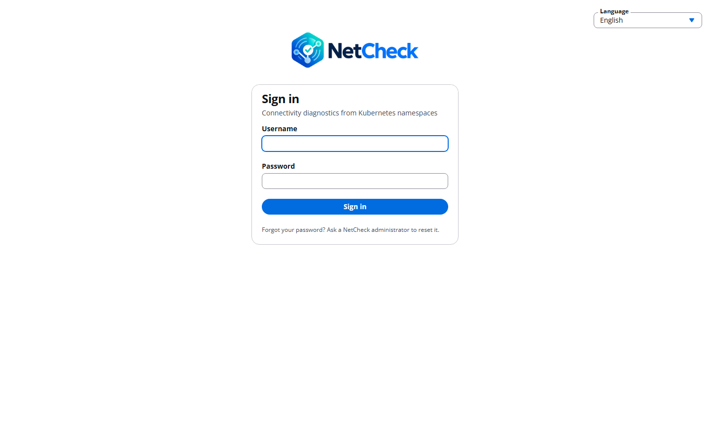

To work in Spanish, pick **Español** in the **Language** selector at the bottom. The choice is **saved in your
account** when you sign in, so NetCheck opens in Spanish in any browser from then on.

- A wrong username or password shows a generic message that does not say which one failed.
- After **5 failed attempts** in a row the account is locked for **15 minutes**. Wait, or ask an administrator to
  unlock it.
- **Forgot your password?** Ask an administrator to reset it. You will get a temporary password.

### 2.2 First sign-in: mandatory password change

The first time, or after an administrator resets your password, you sign in with a **temporary** password and
NetCheck asks you to change it before anything else.

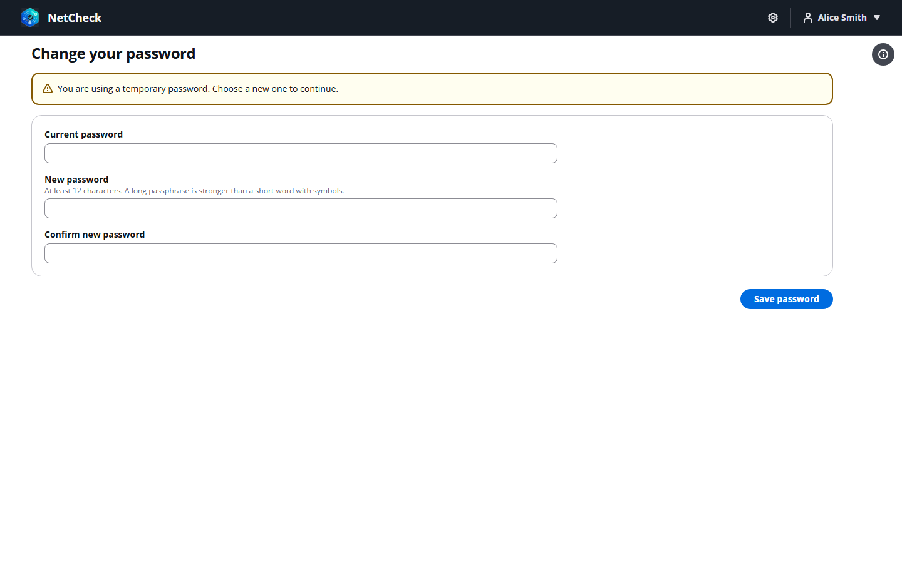

- The new password needs **at least 12 characters** and cannot be your username.
- A long, easy-to-remember phrase ("coffee-at-eight-without-sugar") is stronger than a short word with symbols.

### 2.3 Page layout

NetCheck follows the layout of the AWS console:

- **Top bar:** logo, **preferences** button (gear) and your name, with the user menu.
- **Side navigation:** **Dashboard**, **Create test** and **Test history** (administrators also see
  **Administration**). It can be collapsed with the arrow.
- **Breadcrumbs** above the title of each page.
- **Help panel** (the "i" icon on the right or the **Info** link): a summary of how to read the results.

### 2.4 User menu, preferences and sign out

The menu with your name opens **Preferences**, **Change password** and **Sign out**. Its description shows your
username, your role and the NetCheck version.

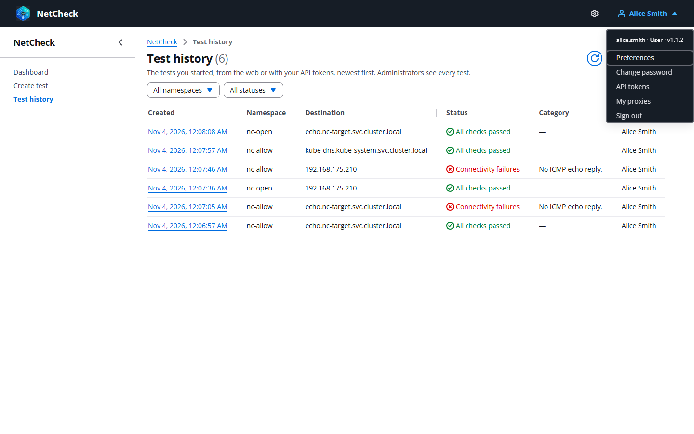

**Preferences** sets the interface language (English / Español). It is saved in your account when you click **Save**.

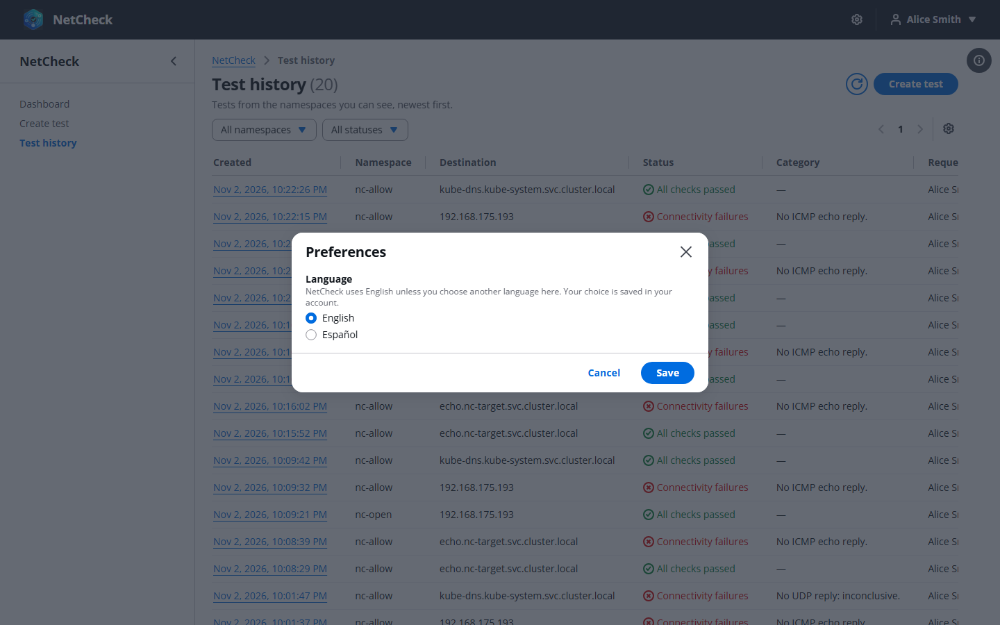

Sessions expire after **60 minutes without activity** and, in any case, after **12 hours**. When that happens
NetCheck returns to the sign-in page.

## 3. Dashboard

The **Dashboard** is the home page. For the namespaces you can see and the last 24 hours it shows the number of tests
and how many passed, had connectivity failures or infrastructure errors; the checks by method; the namespaces you can
test from; and the most recent tests.

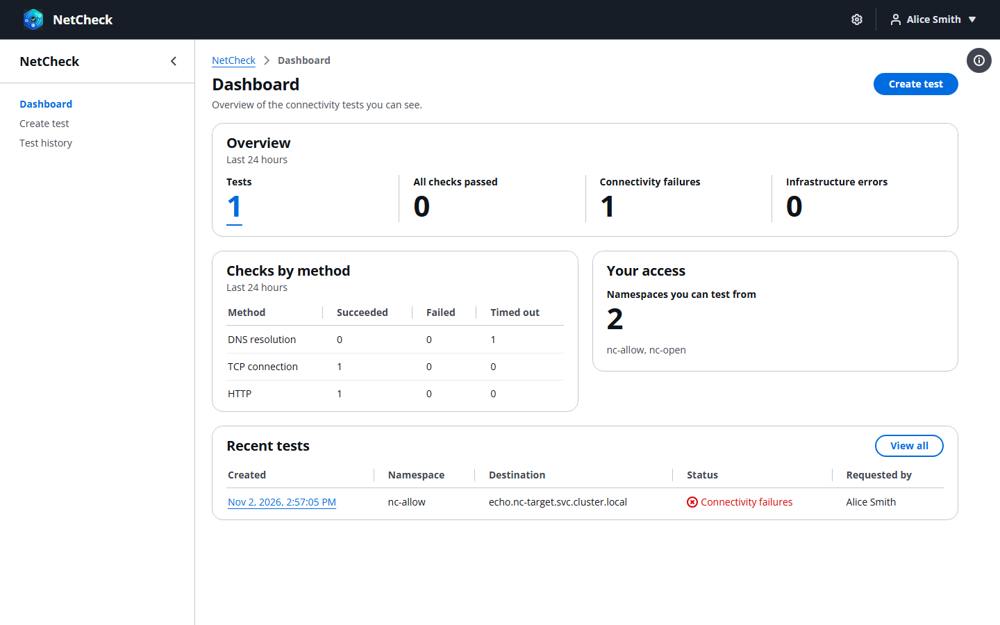

## 4. Creating a test

Click **Create test** in the side navigation (or on the dashboard).

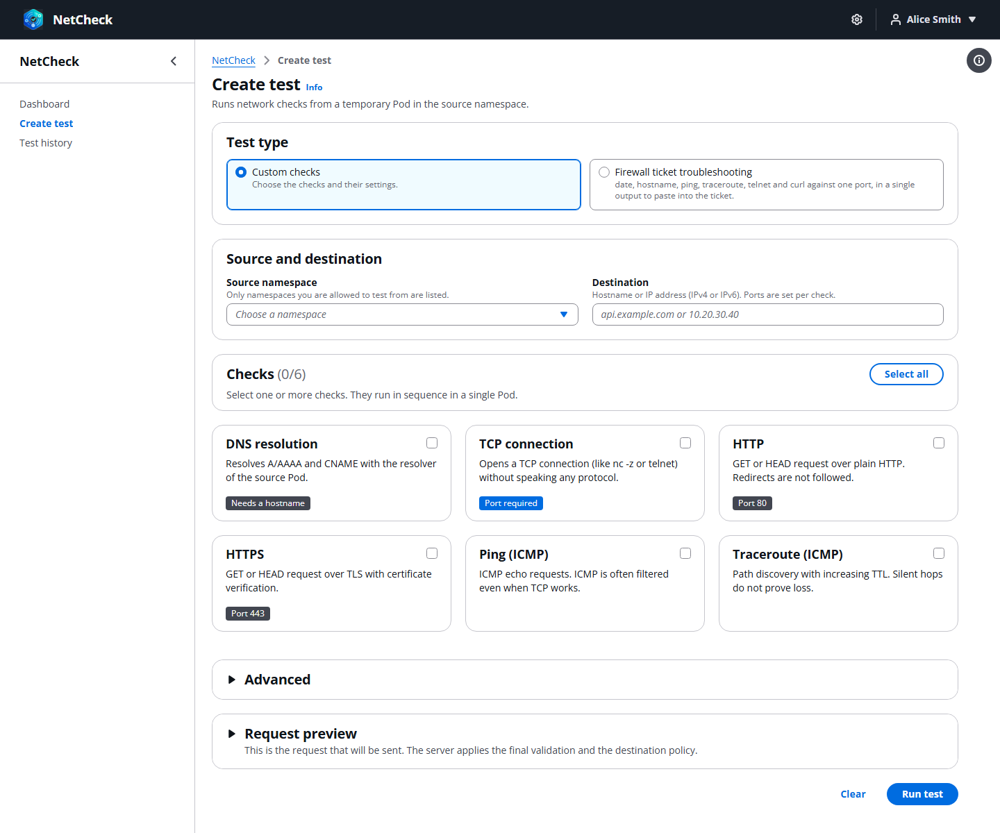

### 4.1 Source and destination

- **Source namespace:** only your assigned namespaces are listed. The test runs **from** that namespace, with its
  NetworkPolicies, its DNS and its network.

  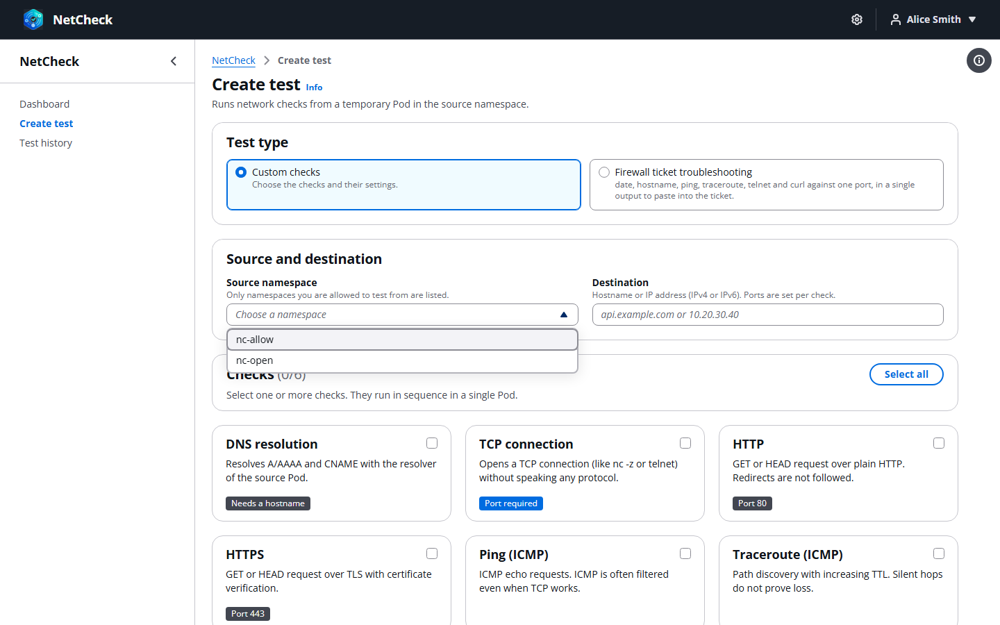

- **Destination:** **only** an IP address (IPv4 or IPv6) or a DNS name (for example
  `api.payments.svc.cluster.local`). URLs, ports and paths are not accepted in this field: the port and the path are set
  **in each check**.

### 4.2 Checks

Select one or more cards (or **Select all**). They run one after another in a single Pod.

| Check | What it verifies | Port | Equivalent to |
|---|---|---|---|
| **DNS resolution** | The name resolves from the source Pod (A/AAAA and CNAME). Needs a name, not an IP | — | `getent ahosts` |
| **TCP connection** | A TCP connection to the port can be established | **Required, no default** | `nc -z` / `telnet` |
| **HTTP** | A web service answers GET or HEAD over plain HTTP | **80** by default, editable | `curl http://…` |
| **HTTPS** | The same over TLS, verifying the certificate | **443** by default, editable | `curl https://…` |
| **Ping (ICMP)** | The destination answers ICMP echo requests | — | `ping -c N` |
| **Traceroute (ICMP)** | The hops (routers) towards the destination | — | `traceroute -I` |

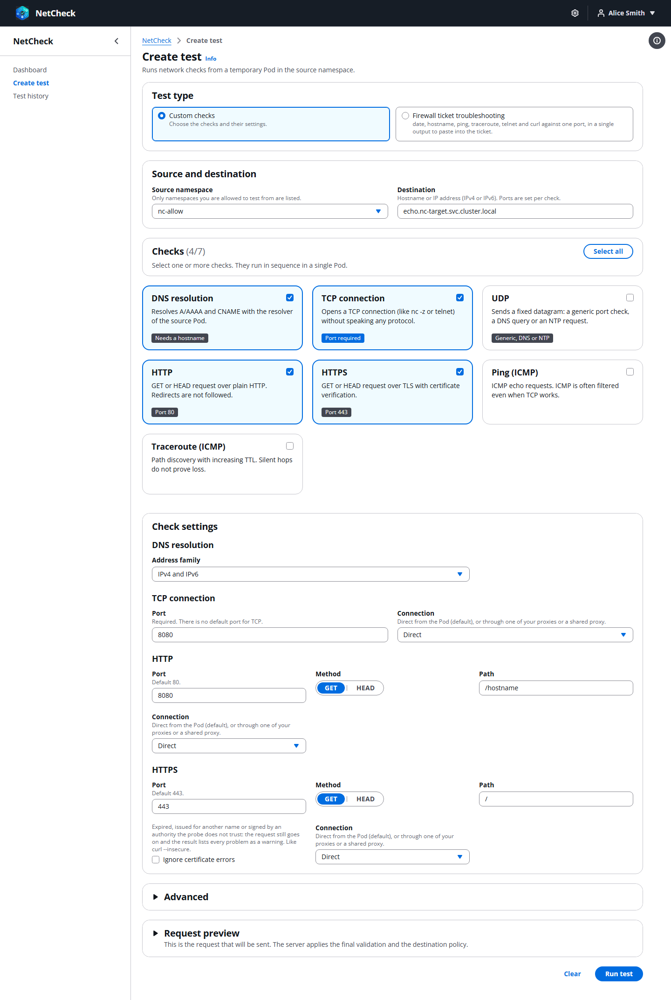

**Check settings** (shown when a card is selected):

- **TCP:** port (required).
- **HTTP / HTTPS:** port, method (GET or HEAD) and path (for example `/health`). Redirects are not followed: you see
  the 3xx code and its target.
- **DNS:** address family (IPv4 and IPv6, IPv4 only or IPv6 only).
- **Ping:** number of echo requests (1–10, one per second).
- **Traceroute:** maximum hops (1–30, at most one second per hop).
- **Advanced → Timeout per check:** for DNS, TCP, HTTP and HTTPS; 5 s by default, 10 s maximum.

Ping and traceroute work **without privileges**: the probe needs neither `NET_RAW` nor root. They use Linux *ping
sockets*, enabled only inside the probe Pod.

### 4.3 Firewall ticket troubleshooting

When you open a firewall ticket you are often asked for the output of `date`, `hostname`, `ping`, `traceroute`,
`telnet` and `curl` against the destination and port, all together. In **Create test → Test type** choose **Firewall
ticket troubleshooting**: you only enter the source namespace, the **destination** (IP or FQDN) and the **port**.

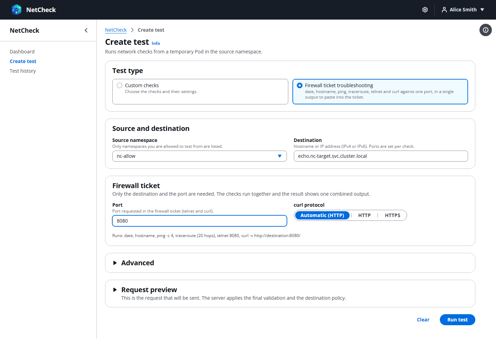

- **curl protocol:** automatic by port (443 and 8443 → HTTPS, anything else → HTTP), or choose HTTP or HTTPS.
- A single Pod runs `ping -c 4`, `traceroute` (20 hops), `telnet <port>` and `curl -v` against `/`, plus `date` and
  `hostname`.

When it finishes, the result shows a **Firewall ticket report** block: **one output** with every command, with **Copy
report** and **Download .txt** buttons to attach it to the ticket.

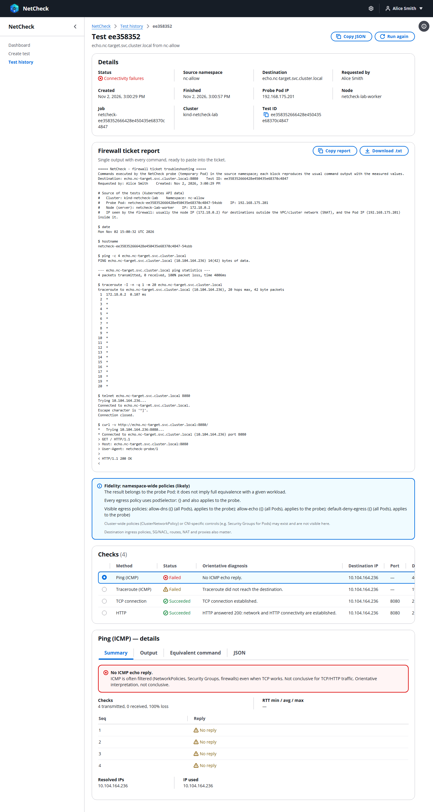

How to read the report:

- The header states that the NetCheck **probe** ran the checks: each block reproduces the usual command output
  (`PING …`, `traceroute to …`, `Trying … Connected to …`, `curl -v`) with **measured** values. Nothing is
  invented: what the probe does not measure (the ping TTL or the full HTTP response headers, for example) is left out.
- **Source of the tests:** cluster, namespace, name and IP of the **probe Pod**, and name and IP of the **node
  (server)** it ran on, taken from the Kubernetes API. **IP seen by the firewall:** traffic to destinations outside
  the VPC or cluster network usually leaves with the **node IP** (SNAT); inside the VPC, with the **Pod IP**. Request
  the rule for the right one.
- There is no `ifconfig`: the probe has no access to the server interfaces (by design), and the Pod's own `ifconfig`
  would not show the server IP. The node IP is in the source block.
- `hostname` shows the probe Pod name; the server name is in the source block.
- Ping and traceroute to a **Kubernetes Service** (cluster IP) get no answer: Services do not reply to ICMP. That is
  expected; for the ticket, `telnet` and `curl` to the port are what matters.

### 4.4 Request preview and running the test

Expand **Request preview** to see exactly what will be sent, then click **Run test**.

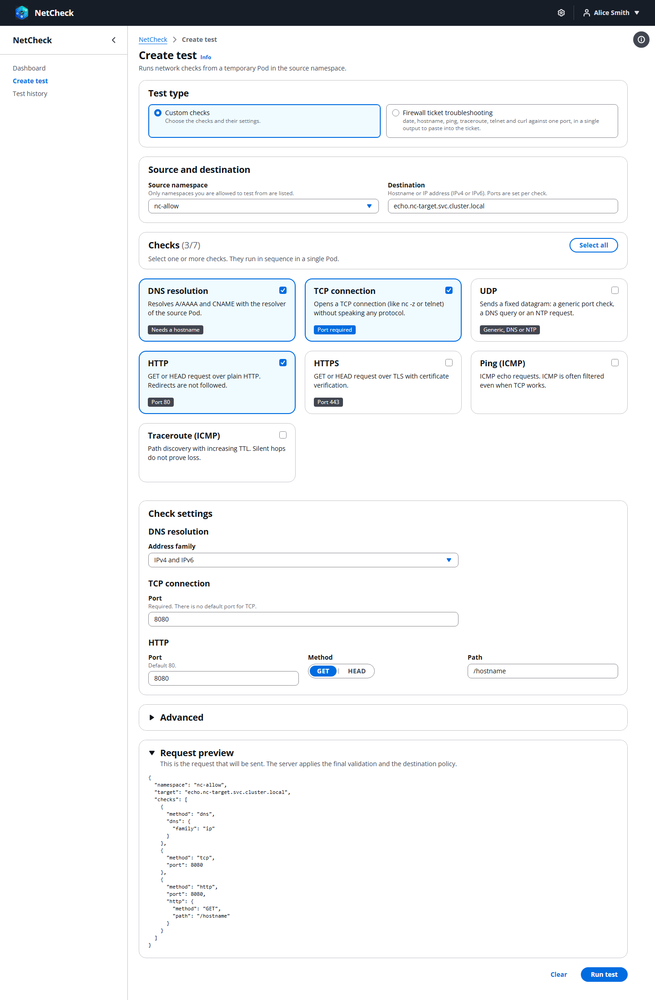

The server performs the final validation. If the destination or the port is not allowed by the destination policy
(managed by administrators), or it is a protected destination such as the cloud metadata service, the test is rejected
**without sending any traffic** and the message gives the exact reason:

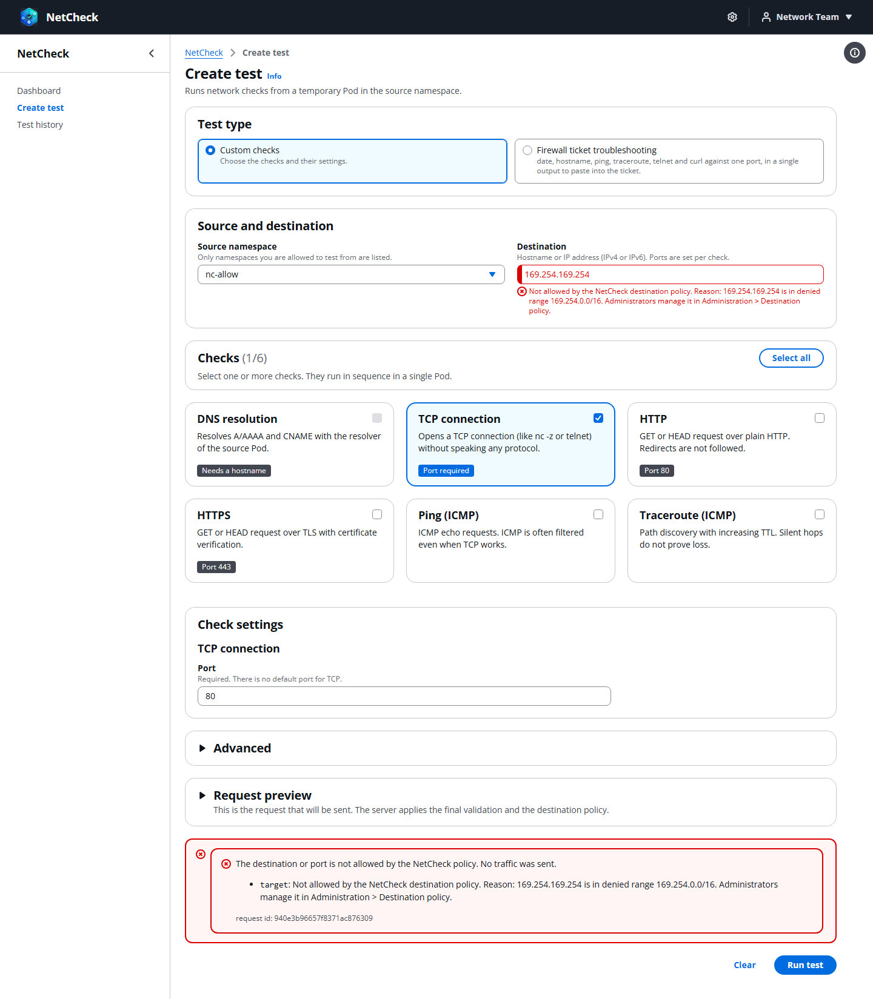

## 5. Reading the result

The result page refreshes by itself while the probe works (usually 5 to 30 seconds; ping and traceroute take longer).
**Run again** opens the form filled in with the same values and **Copy JSON** copies the full result.

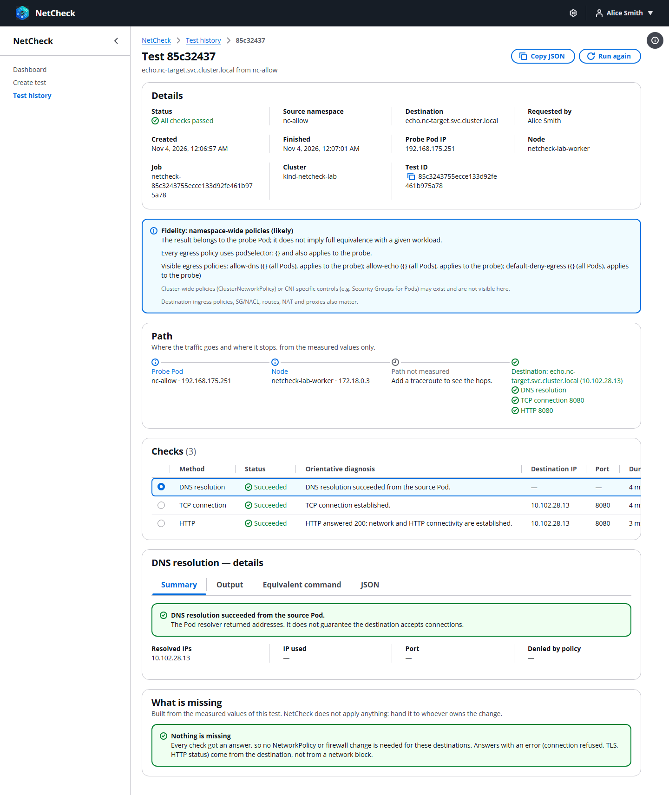

### 5.1 Overall status

| Status | Meaning |
|---|---|
| Queued / Running | The probe is being created or is measuring |
| **All checks passed** | Every check succeeded |
| **Connectivity failures** | At least one network check failed (refused, timed out, DNS, no ICMP reply…) |
| **Infrastructure error** | NetCheck could not run the probe (permissions, quota, image…). **It is not a network result**: tell your platform team |

The **Details** block also shows the **probe Pod IP** and the **node** the measurement came from.

### 5.2 Interpreting each check

| Result | What it means | What it does **not** mean |
|---|---|---|
| TCP **Succeeded** | There is a TCP path from that namespace to that port | That the application works |
| TCP **Connection refused** | The packet arrived and something answered "no" (nothing listens on the port, or the Service has no endpoints) | A NetworkPolicy block |
| TCP **Timed out** | No answer. It can be a NetworkPolicy (source or destination), a Security Group, a NACL, routing, or the destination being down | Proof that a NetworkPolicy blocks it |
| DNS **NXDOMAIN** | The name does not exist for that resolver | A network problem |
| DNS **Timed out** | The resolver could not be reached (a policy blocking port 53?) | — |
| HTTP/HTTPS **200–299** | The service answered fine | — |
| HTTP/HTTPS **401/403/404/5xx** | **There is connectivity**; the problem is in the application. Shown as a warning, not as a network failure | A network problem |
| TLS **certificate not valid** | It connected, but the certificate is not trusted or does not match the name | A network block |
| Ping **no reply** | No echo reply arrived | That TCP is blocked: ICMP is often filtered while TCP works |
| Ping **partial loss** | Some requests got no reply; the host is reachable | — |
| Traceroute **incomplete** | The destination was not reached; hops shown as `*` did not answer | Packet loss: many routers and policies do not answer ICMP |
| **Destination denied** | The NetCheck policy does not allow that destination; no traffic was sent | A network result |

### 5.3 Ping and traceroute

The **ping** detail shows packets sent and received, the loss percentage, the minimum, average and maximum RTT, and
the answer to each request. The **traceroute** detail lists each hop with its address and RTT.

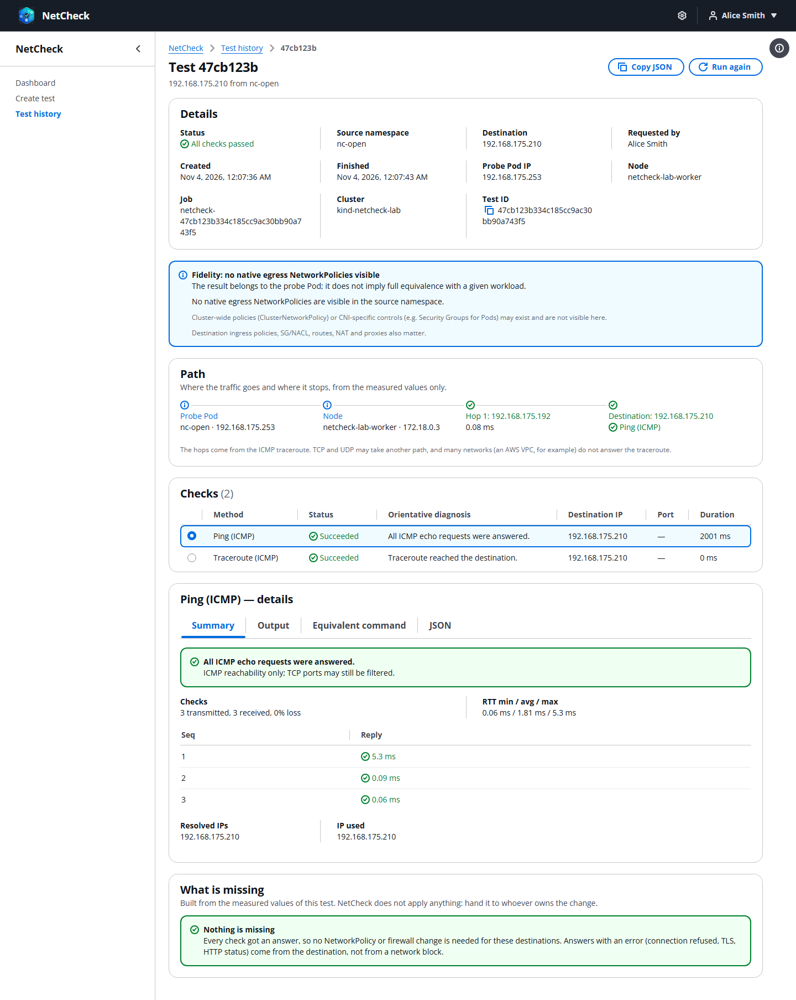

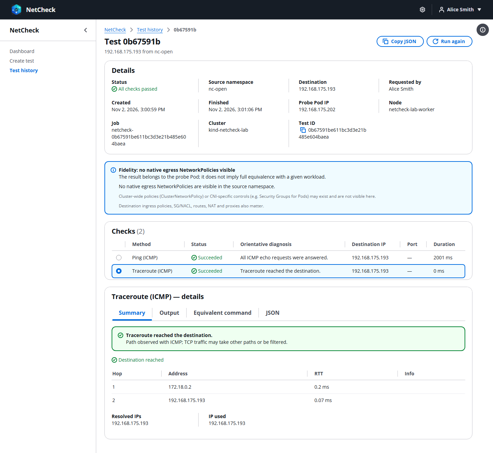

An important example: from a namespace whose NetworkPolicies only allow DNS and TCP 8080, **TCP to port 8080 works**
but **ping gets no reply**. A failed ping therefore does not prove that your application cannot connect: always check
with TCP or HTTP(S) on the real port.

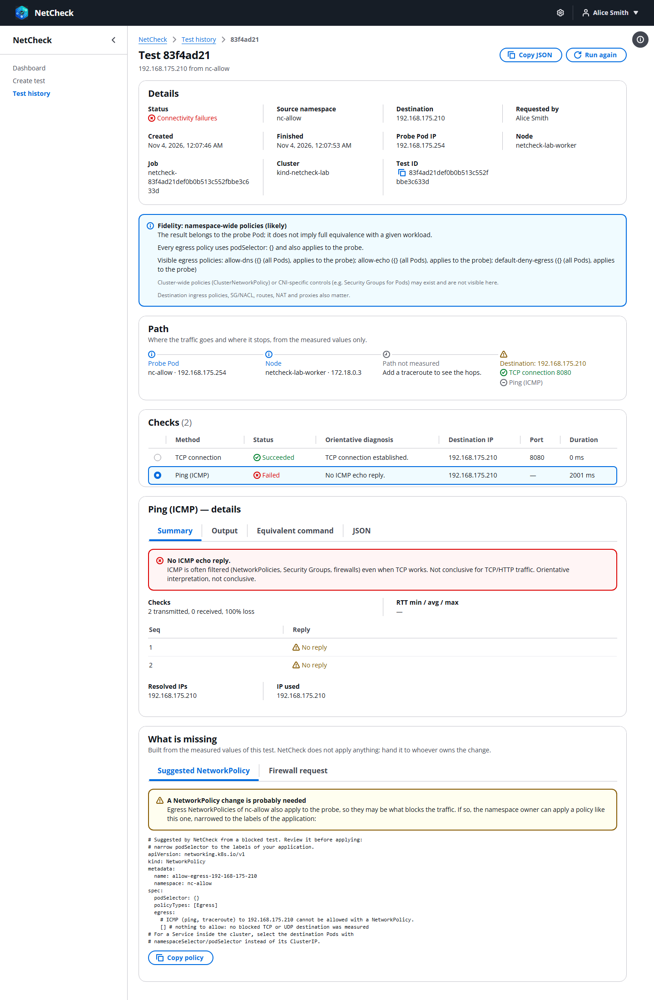

### 5.4 Fidelity notice

The result belongs to the **probe Pod**, whose labels, ServiceAccount and IP differ from your application's. The
fidelity notice tells you how representative it is:

- **Namespace-wide policies (likely):** every egress policy in the namespace uses `podSelector: {}`, so it applies to
  the probe and to your application alike.
- **Some policies use specific selectors:** a policy only applies to Pods with certain labels. Your application may get
  different rules than the probe (in the example, `allow-echo-legacy-only` only applies to `app=legacy`).
- **No native egress NetworkPolicies visible** or **Fidelity unknown.**

Other layers may always exist and are not visible here: Security Groups for Pods, `ClusterNetworkPolicy`, policies on
the destination side and firewalls.

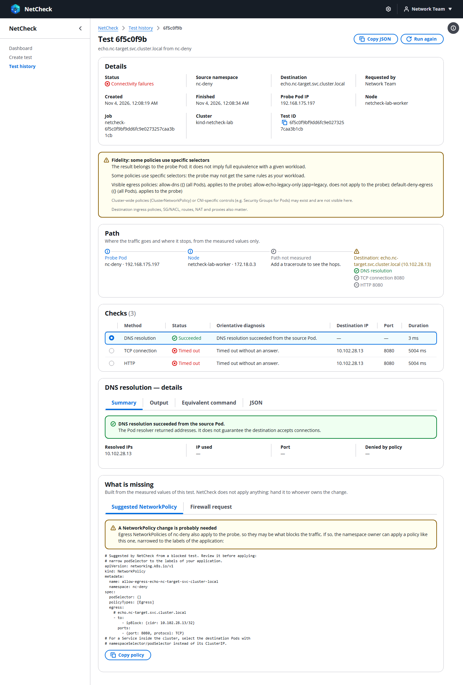

### 5.5 Check details

Select a row of the **Checks** table to see its details below, in these tabs:

- **Summary:** diagnosis, resolved IPs, IP and port used, IPs denied by policy, HTTP status, TLS version, certificate,
  and connect / TLS / first-byte timings (or the ping and traceroute tables).
- **Output:** the probe's technical trace.
- **Equivalent command:** an approximate command (`getent`, `nc`, `curl`, `ping` or `traceroute`) to reproduce the
  check by hand, with a **Copy** button. The probe does not run it: it uses its own network primitives.
- **JSON:** the complete result, to attach to an incident.

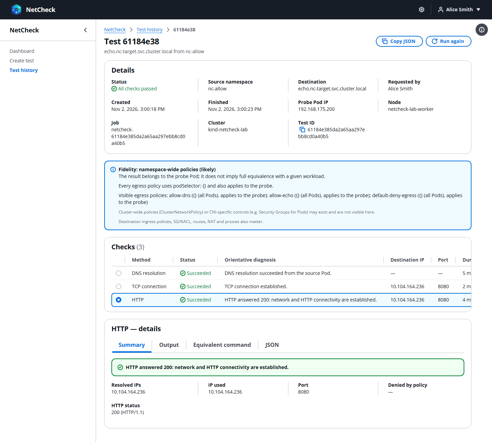

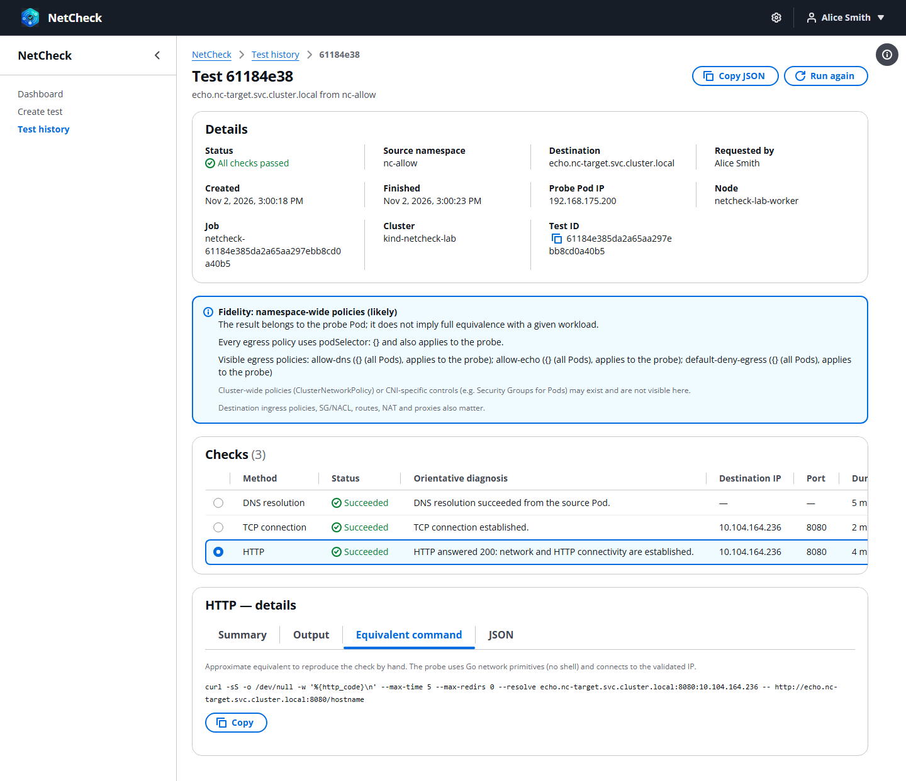

A timeout caused by a NetworkPolicy that blocks egress:

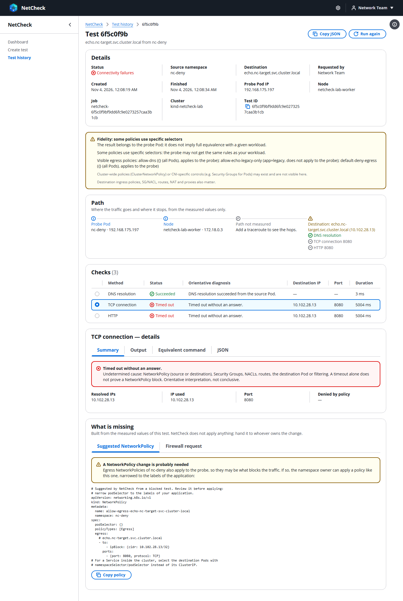

## 6. Test history

**Test history** lists the tests of your namespaces, newest first, with filters by namespace and status. Click the
date to open the full result. The gear icon of the table sets the page size and the visible columns (remembered in
your browser).

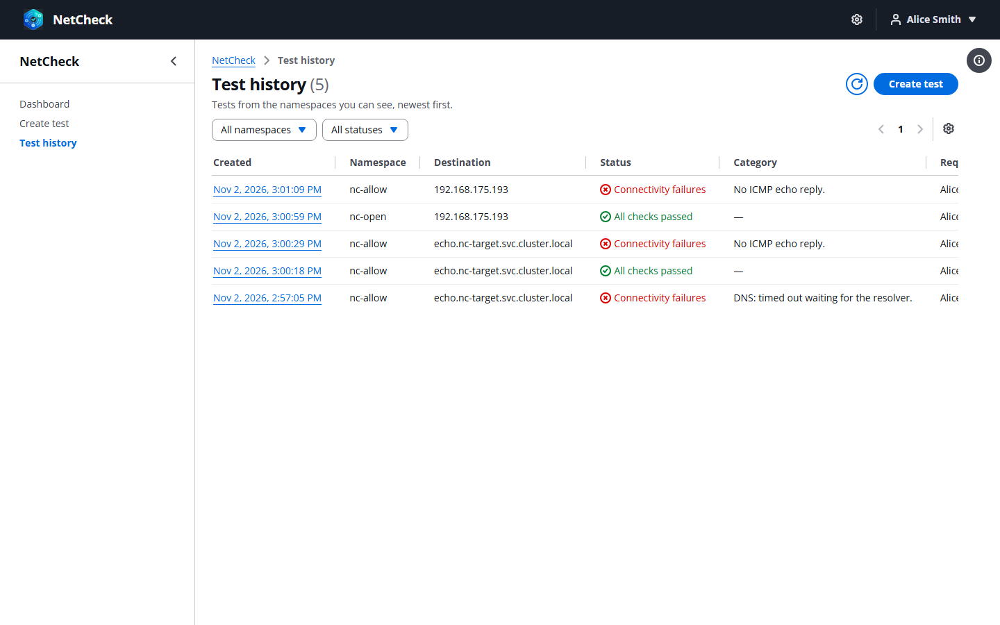

Technical output is kept for 15 days and the rest of the data for 45 days (or whatever your administrators configured).

## 7. Changing your password

User menu → **Change password**. Enter the current password and the new one twice. Saving signs out your other
sessions in other browsers.

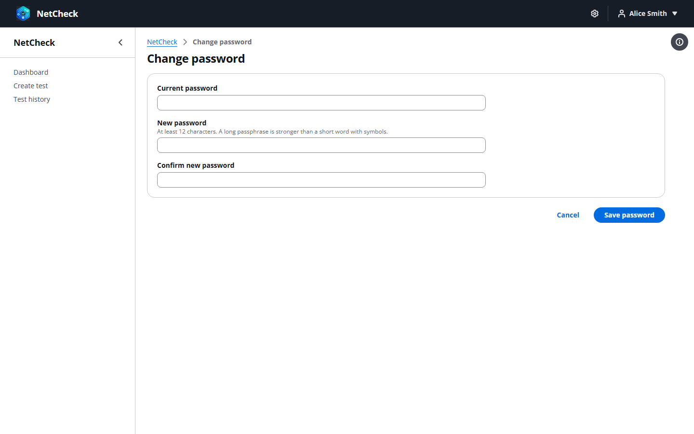

## 8. FAQ

**I cannot see the namespace I need.** Ask an administrator to assign it to you or, if it was excluded, to include it
again in **Administration → Namespaces**. If you have "All namespaces" and the namespace is new, it can take up to a
minute to appear. System namespaces (`kube-system`, `default`…) are never available, and the NetCheck namespace only
if an administrator enables it for your account.

**"Not allowed by the NetCheck destination policy".** By default you can test any name, IP and port (for example
`www.google.com`), except a few destinations protected for security reasons: the cloud metadata service
(`169.254.169.254`), the Kubernetes API server, loopback (`127.0.0.1`) and link-local addresses. It is also rejected if
an administrator restricted destinations in **Administration → Destination policy** (ask them to add it; the change is
immediate). The message gives the exact reason and no traffic was sent.

**Why does TCP have no default port?** To avoid testing, by mistake, a port that is not your service's. HTTP and HTTPS
default to 80 and 443 because those are the standard ports, but you can change them.

**Ping fails but my application works.** That is normal: ICMP is often filtered (NetworkPolicies, Security Groups,
firewalls) while TCP is allowed. Test with TCP or HTTP(S) on the real port.

**My application cannot reach a destination, but NetCheck says "Succeeded".** The probe may get different rules than
your application (check the fidelity notice): Security Groups for Pods, policies with selectors, service meshes or
sidecars. Share the result with your platform team.

**I got "Infrastructure error".** It is not a problem with your network. Copy the test ID and the message and send
them to your platform team.

**"Too many sign-in attempts".** Wait one minute and try again.

**The firewall team asks for the server's `ifconfig`.** NetCheck cannot show it: the probe is a Pod without access to
the server interfaces, by design. The firewall ticket report includes the real node (server) and Pod IPs taken from
Kubernetes and explains which one the firewall will see. If the firewall team insists on the server's `ifconfig`, ask
your platform team.

**Can I test UDP?** Not yet. Supported checks are DNS, TCP, HTTP, HTTPS, ping and traceroute (ICMP).
